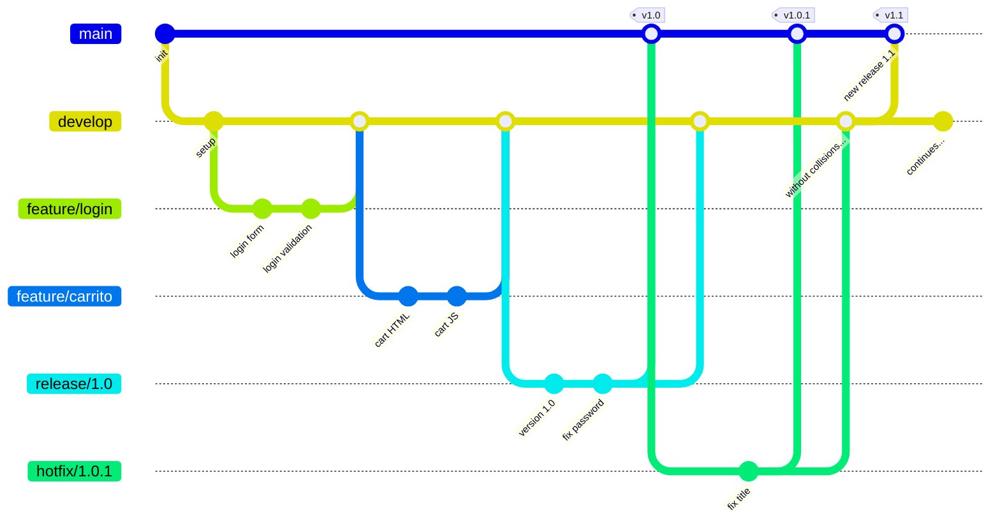

# 📘 Git Flow: flujo de trabajo con ramas

## Introducción

Cuando un equipo de desarrollo trabaja sobre un mismo proyecto, necesita una forma organizada de gestionar los cambios. **Git Flow** es un modelo de ramificación que define qué ramas usar, cuándo crearlas y cómo integrarlas.

Fue propuesto por Vincent Driessen en 2010 y se convirtió en uno de los flujos de trabajo más utilizados en la industria.

### ¿Por qué no alcanza con usar solo main?

Si todos trabajan directamente sobre `main`:

* cualquier error rompe la versión estable;
* no hay forma de desarrollar funcionalidades en paralelo sin pisarse;
* no se puede preparar una versión de entrega mientras se sigue desarrollando.

Git Flow resuelve estos problemas definiendo **roles claros para cada rama**.


## Las ramas de Git Flow

Git Flow trabaja con cinco tipos de ramas:

| Rama | Propósito | Se crea desde | Se fusiona en |
|---|---|---|---|
| `main` | Versión estable en producción | — | — |
| `develop` | Rama de integración para desarrollo | `main` | `main` (via release) |
| `feature/*` | Desarrollo de una funcionalidad nueva | `develop` | `develop` |
| `release/*` | Preparación de una nueva versión | `develop` | `main` y `develop` |
| `hotfix/*` | Corrección urgente en producción | `main` | `main` y `develop` |

### Diagrama general



### Ramas permanentes vs temporales

* **Permanentes**: `main` y `develop` existen durante toda la vida del proyecto.
* **Temporales**: `feature`, `release` y `hotfix` se crean, se usan y se eliminan.


## Ejemplo completo: proyecto "Tienda Online"

Vamos a simular el desarrollo de una tienda online aplicando Git Flow paso a paso.

### Paso 0: Crear el proyecto e inicializar Git Flow

```bash
mkdir tienda-online
cd tienda-online
git init
```

Crear un archivo inicial y hacer el primer commit en `main`:

```bash
echo "<h1>Tienda Online</h1>" > index.html
git add index.html
git commit -m "Commit inicial con página principal"
```

Crear la rama `develop` a partir de `main`:

```bash
git switch -c develop
```

Ahora tenemos las dos ramas permanentes:

```bash
git branch
```

```text
* develop
  main
```


## Feature branches: desarrollar funcionalidades

Cada nueva funcionalidad se desarrolla en una rama `feature/*` que nace desde `develop`.

### Ejemplo 1: Feature login

El Programador 1 va a desarrollar el sistema de login.

#### Crear la rama

```bash
git switch develop
git switch -c feature/login
```

#### Trabajar en la funcionalidad

```bash
echo "<form>
  <input type='text' placeholder='Usuario'>
  <input type='password' placeholder='Contraseña'>
  <button>Ingresar</button>
</form>" > login.html
git add login.html
git commit -m "Agrega formulario de login"
```

Luego agrega validación:

```bash
echo "function validarLogin(user, pass) {
  if (!user || !pass) {
    return 'Campos obligatorios';
  }
  return 'OK';
}" > login.js
git add login.js
git commit -m "Agrega validación básica de login"
```

#### Integrar en develop

Cuando la funcionalidad está lista:

```bash
git switch develop
git merge feature/login
```

```text
Updating abc1234..def5678
Fast-forward
 login.html | 5 +++++
 login.js   | 6 ++++++
 2 files changed, 11 insertions(+)
```

Eliminar la rama (ya no se necesita):

```bash
git branch -d feature/login
```

### Ejemplo 2: Feature carrito (en paralelo)

Mientras el Programador 1 trabajaba en login, el Programador 2 desarrolla el carrito de compras.

#### Crear la rama

```bash
git switch develop
git switch -c feature/carrito
```

#### Trabajar en la funcionalidad

```bash
echo "<div id='carrito'>
  <h2>Tu carrito</h2>
  <ul id='items'></ul>
  <p>Total: $0</p>
</div>" > carrito.html
git add carrito.html
git commit -m "Agrega estructura HTML del carrito"
```

```bash
echo "let carrito = [];

function agregarProducto(nombre, precio) {
  carrito.push({ nombre, precio });
}

function calcularTotal() {
  return carrito.reduce((sum, item) => sum + item.precio, 0);
}" > carrito.js
git add carrito.js
git commit -m "Agrega lógica del carrito de compras"
```

#### Integrar en develop

```bash
git switch develop
git merge feature/carrito
git branch -d feature/carrito
```

### Estado actual de develop

Ahora `develop` tiene todo integrado:

```text
index.html    (del commit inicial)
login.html    (de feature/login)
login.js      (de feature/login)
carrito.html  (de feature/carrito)
carrito.js    (de feature/carrito)
```

Mientras que `main` sigue solo con `index.html`.


## Release branches: preparar una versión

Cuando `develop` tiene suficientes funcionalidades para una entrega, se crea una rama `release/*`.

### ¿Qué se hace en una release branch?

* Corregir errores menores encontrados durante la revisión.
* Ajustar números de versión.
* Actualizar documentación.
* **No agregar funcionalidades nuevas.**

### Ejemplo: Release 1.0

#### Crear la rama

```bash
git switch develop
git switch -c release/1.0
```

#### Hacer ajustes de versión

```bash
echo "# Tienda Online
Versión: 1.0
Fecha: $(date +%Y-%m-%d)

## Funcionalidades
- Página principal
- Sistema de login
- Carrito de compras" > VERSION.md
git add VERSION.md
git commit -m "Agrega archivo de versión para release 1.0"
```

Se detecta un bug menor en el login durante la revisión:

```bash
echo "function validarLogin(user, pass) {
  if (!user || !pass) {
    return 'Campos obligatorios';
  }
  if (pass.length < 6) {
    return 'La contraseña debe tener al menos 6 caracteres';
  }
  return 'OK';
}" > login.js
git add login.js
git commit -m "Agrega validación de largo mínimo de contraseña"
```

#### Fusionar en main y en develop

Cuando la release está lista, se fusiona en ambas ramas:

Primero en `main`:

```bash
git switch main
git merge release/1.0
```

Crear un tag para marcar la versión:

```bash
git tag -a v1.0 -m "Versión 1.0 - Login y carrito"
```

Luego en `develop` (para que los fixes de la release no se pierdan):

```bash
git switch develop
git merge release/1.0
```

Eliminar la rama:

```bash
git branch -d release/1.0
```

### Estado después de la release

```text
main:     tiene todo hasta v1.0 (index, login, carrito, VERSION)
develop:  tiene lo mismo + cualquier feature nueva que se haya empezado
```


## Hotfix branches: correcciones urgentes

Un hotfix se usa cuando hay un **bug crítico en producción** que no puede esperar a la próxima release.

### Ejemplo: Hotfix 1.0.1

Un usuario reporta que la página principal muestra un título incorrecto en producción.

#### Crear la rama desde main

```bash
git switch main
git switch -c hotfix/1.0.1
```

#### Aplicar la corrección

```bash
echo "<h1>Tienda Online - Tu lugar de compras</h1>
<nav>
  <a href='login.html'>Ingresar</a>
  <a href='carrito.html'>Carrito</a>
</nav>" > index.html
git add index.html
git commit -m "Corrige título y agrega navegación en página principal"
```

#### Fusionar en main y en develop

En `main`:

```bash
git switch main
git merge hotfix/1.0.1
git tag -a v1.0.1 -m "Hotfix: corrección de título en página principal"
```

En `develop` (para que el fix también esté disponible en desarrollo):

```bash
git switch develop
git merge hotfix/1.0.1
```

Eliminar la rama:

```bash
git branch -d hotfix/1.0.1
```


## Ejemplo de conflicto en Git Flow

Los conflictos también ocurren en Git Flow, especialmente al fusionar ramas que tocaron los mismos archivos.

### Escenario

Mientras la `release/1.0` corregía `login.js`, alguien en `develop` también lo modificó en una nueva feature.

Al hacer `git merge release/1.0` en `develop`:

```text
Auto-merging login.js
CONFLICT (content): Merge conflict in login.js
Automatic merge failed; fix conflicts and then commit the result.
```

El archivo queda así:

```text
function validarLogin(user, pass) {
  if (!user || !pass) {
    return 'Campos obligatorios';
  }
<<<<<<< HEAD
  if (user.includes('@')) {
    return 'No usar email como usuario';
  }
=======
  if (pass.length < 6) {
    return 'La contraseña debe tener al menos 6 caracteres';
  }
>>>>>>> release/1.0
  return 'OK';
}
```

### Resolución

En este caso conviene **conservar ambas validaciones**:

```javascript
function validarLogin(user, pass) {
  if (!user || !pass) {
    return 'Campos obligatorios';
  }
  if (user.includes('@')) {
    return 'No usar email como usuario';
  }
  if (pass.length < 6) {
    return 'La contraseña debe tener al menos 6 caracteres';
  }
  return 'OK';
}
```

```bash
git add login.js
git commit -m "Resuelve conflicto: integra validaciones de develop y release"
```


## Convenciones de nombres

| Tipo | Formato | Ejemplo |
|---|---|---|
| Feature | `feature/nombre-descriptivo` | `feature/login`, `feature/carrito`, `feature/busqueda` |
| Release | `release/numero-version` | `release/1.0`, `release/2.1` |
| Hotfix | `hotfix/numero-version` | `hotfix/1.0.1`, `hotfix/2.1.3` |

### Buenos nombres de feature

* `feature/login`
* `feature/carrito-de-compras`
* `feature/filtro-por-categoria`

### Malos nombres de feature

* `feature/cosas`
* `feature/test`
* `feature/rama-de-juan`


## Resumen de comandos

### Inicializar

```bash
git switch -c develop        # Crear develop desde main
```

### Feature

```bash
git switch develop
git switch -c feature/X      # Crear feature
# ... trabajar, hacer commits ...
git switch develop
git merge feature/X          # Integrar en develop
git branch -d feature/X      # Eliminar feature
```

### Release

```bash
git switch develop
git switch -c release/X.Y    # Crear release
# ... ajustes finales ...
git switch main
git merge release/X.Y        # Fusionar en main
git tag -a vX.Y -m "msg"     # Crear tag
git switch develop
git merge release/X.Y        # Fusionar en develop
git branch -d release/X.Y    # Eliminar release
```

### Hotfix

```bash
git switch main
git switch -c hotfix/X.Y.Z   # Crear hotfix
# ... corregir el bug ...
git switch main
git merge hotfix/X.Y.Z       # Fusionar en main
git tag -a vX.Y.Z -m "msg"   # Crear tag
git switch develop
git merge hotfix/X.Y.Z       # Fusionar en develop
git branch -d hotfix/X.Y.Z   # Eliminar hotfix
```


💬 Preguntas y respuestas:

* ¿Es obligatorio usar Git Flow?
  → No. Es una convención, no una regla de Git. Pero ayuda a mantener el orden en equipos.
* ¿Puedo hacer commits directamente en develop?
  → Técnicamente sí, pero Git Flow recomienda usar siempre feature branches para mantener develop estable.
* ¿Qué pasa si hago un feature branch desde main en vez de develop?
  → El feature no tendría los últimos cambios de desarrollo. Siempre debe nacer desde develop.
* ¿Puedo tener varias features a la vez?
  → Sí. Esa es precisamente la idea: cada funcionalidad en su propia rama, en paralelo.
* ¿Cuándo elimino una rama?
  → Después de fusionarla. Una vez integrada, la rama temporal ya cumplió su propósito.
* ¿Qué es un tag?
  → Es una etiqueta que marca un commit específico. Se usa para identificar versiones publicadas (v1.0, v2.0, etc.).
* ¿El hotfix puede generar conflictos al fusionarse en develop?
  → Sí, si develop avanzó y tocó los mismos archivos. Se resuelve como cualquier conflicto.
