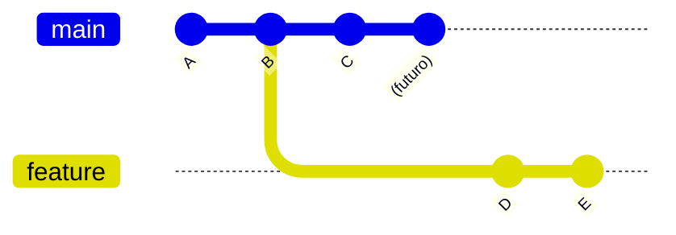
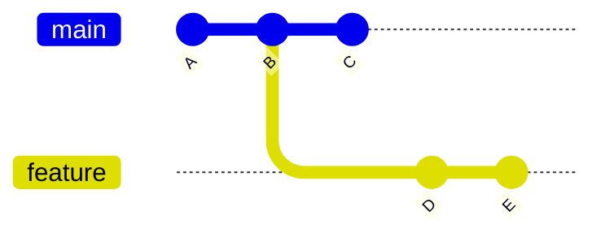
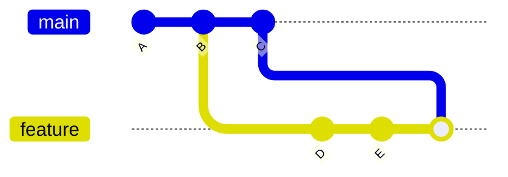
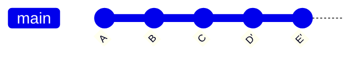
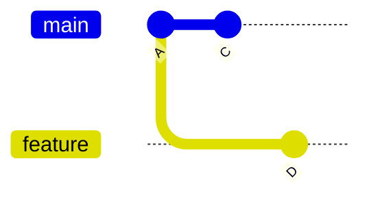
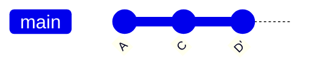

# Git: Rebase vs Merge

## 1. Introducción

En Git, cuando se trabaja con múltiples ramas (branches), es necesario integrar cambios entre ellas. Existen dos estrategias principales para hacerlo:

* **Merge**
* **Rebase**

Ambas permiten combinar cambios, pero difieren en cómo manejan la historia del repositorio.


## 2. Escenario de ejemplo

Supongamos la siguiente situación:



### Interpretación

* La rama `feature` se crea a partir del commit `B`.
* La rama `main` continúa avanzando (por ejemplo, hasta `C` y más adelante).
* La rama `feature` evoluciona de forma independiente con los commits `D` y `E`.

> Importante: aunque el diagrama pueda no mostrarlo claramente, la rama `main` **no se detiene** en `C`. Git siempre permite que la historia continúe.


## 3. Uso de Merge

### Estado ANTES del merge



* `feature` se separó en `B`
* `main` avanzó hasta `C`


### Comando

```
git checkout feature
git merge main
```


### Estado DESPUÉS del merge



### Interpretación

* Se crea un nuevo commit de merge.
* La historia mantiene la bifurcación.
* No se reescriben commits.


### Características

**Ventajas:**

* No modifica la historia existente.
* Seguro para trabajo colaborativo.

**Desventajas:**

* Genera una historia más compleja.


## 4. Uso de Rebase

### Estado ANTES del rebase


* `feature` se separó en `B`
* `main` avanzó hasta `C`


### Comando

```
git checkout feature
git rebase main
```


### Estado DESPUÉS del rebase



### Interpretación

* Los commits `D` y `E` se reaplican sobre `C`.
* Se generan nuevos commits (`D'`, `E'`).
* La historia queda lineal.
* La rama `main` **no cambia**.


## 5. Diferencia conceptual

Diferencia conceptual

* **Merge**: trae los cambios de otra rama hacia la rama actual.
* **Rebase**: mueve la base de la rama actual hacia otra rama.


## 6. Ejemplo práctico paso a paso

### Crear repositorio

```
git init

echo "base" > file.txt
git add .
git commit -m "A"

echo "main cambio 1" >> file.txt
git commit -am "B"

git checkout -b feature

echo "feature 1" >> file.txt
git commit -am "D"

echo "feature 2" >> file.txt
git commit -am "E"

git checkout main

echo "main cambio 2" >> file.txt
git commit -am "C"
```


### Aplicar rebase

```
git checkout feature
git rebase main
```


## 7. Resolución de conflictos en rebase

### Ejemplo completo reproducible

Este ejemplo permite provocar un conflicto real durante un rebase.

#### Paso 1: Crear repositorio

```bash
git init

echo "línea original" > archivo.txt
git add .
git commit -m "A"
```


#### Paso 2: Crear rama feature y modificar

```bash
git checkout -b feature

echo "línea modificada en feature" > archivo.txt
git commit -am "D"
```


#### Paso 3: Volver a main y generar conflicto

```bash
git checkout main

echo "línea modificada en main" > archivo.txt
git commit -am "C"
```


#### Estado antes del rebase




#### Paso 4: Ejecutar rebase

```bash
git checkout feature
git rebase main
```


#### Error generado

```bash
CONFLICT (content): Merge conflict in archivo.txt
```


#### Contenido del archivo en conflicto

```
<<<<<<< HEAD
línea modificada en main
=======
línea modificada en feature
>>>>>>> D
```


#### Resolución

Editar el archivo, por ejemplo:

```
línea modificada en main y feature
```


#### Continuar el proceso

```bash
git add archivo.txt
git rebase --continue
```


#### Estado después del rebase




### Opciones útiles

Abortar el rebase:

```bash
git rebase --abort
```

Saltar el commit conflictivo:

```bash
git rebase --skip
```


### Escenario con conflicto

Supongamos que tanto `main` como `feature` modifican la misma línea:

```
main (antes):
Línea original

feature (antes):
Línea original
```

#### Cambios realizados

* En `main`:

```
Línea modificada en main
```

* En `feature`:

```
Línea modificada en feature
```


### Al ejecutar rebase

```
git checkout feature
git rebase main
```

Git detecta el conflicto:

```
CONFLICT (content): Merge conflict in file.txt
```


### Contenido del archivo en conflicto

Git marca el conflicto así:

```
<<<<<<< HEAD
Línea modificada en main
=======
Línea modificada en feature
>>>>>>> D
```


### Interpretación

* `HEAD` → contenido de `main`
* Parte inferior → contenido de `feature`


### Resolución manual

El desarrollador debe decidir el resultado final. Ejemplo:

```
Línea modificada en main y feature
```


### Continuar el rebase

```
git add file.txt
git rebase --continue
```


### Opciones adicionales

Abortar el rebase:

```
git rebase --abort
```

Saltar el commit conflictivo:

```
git rebase --skip
```


## 8. Comparación visual

### Merge


### Rebase


Este esquema muestra el resultado lógico del rebase: una historia lineal. Los commits `D'` y `E'` representan nuevas versiones de `D` y `E`, reaplicadas sobre `C`.


## 9. Cuándo usar cada uno

### Usar Rebase cuando:

* Se desea una historia lineal.
* Se trabaja en una rama local.
* Antes de integrar cambios a `main`.

Ejemplo típico:

```
git fetch origin
git rebase origin/main
```


### Usar Merge cuando:

* La rama es compartida con otros desarrolladores.
* No se quiere modificar la historia.
* Se integran cambios finales.


## 10. Regla importante

**Nunca hacer rebase sobre una rama que ya fue compartida (push).**

Esto puede:

* Romper la historia del repositorio.
* Generar conflictos en otros desarrolladores.


## 11. Flujo de trabajo recomendado

```
git checkout feature
git fetch origin
git rebase origin/main

git push --force-with-lease
```


## 12. Conclusión

* Merge mantiene la historia real de desarrollo.
* Rebase produce una historia más limpia y lineal.

Ambas herramientas son fundamentales y deben utilizarse según el contexto del proyecto y el trabajo en equipo.
