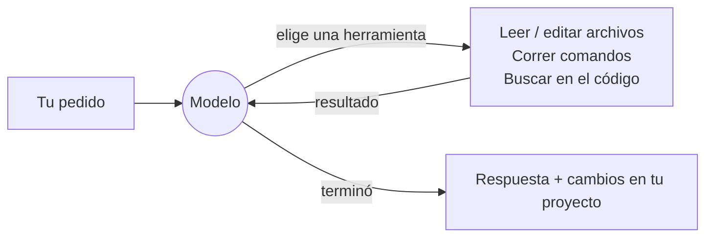
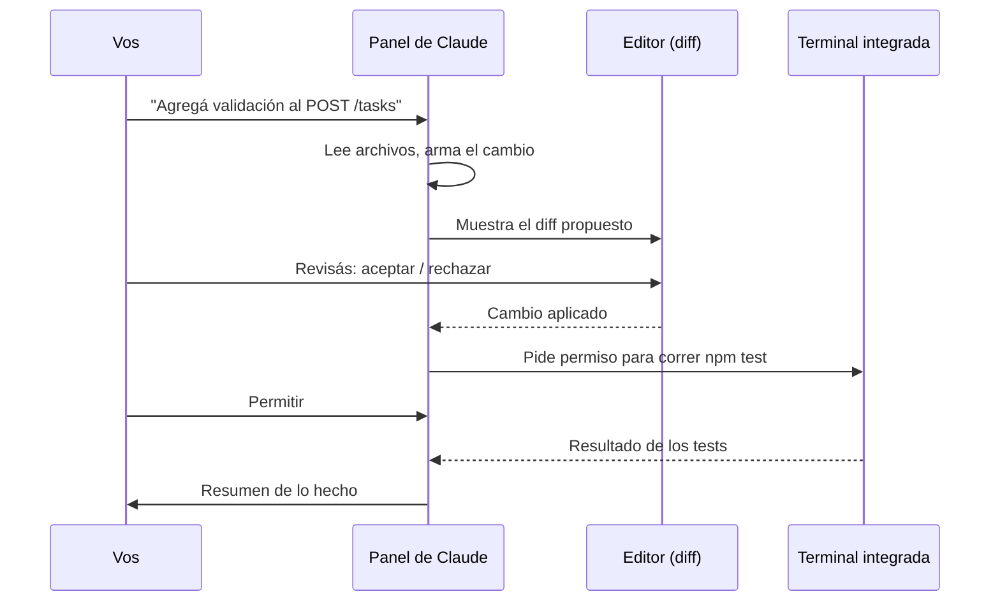
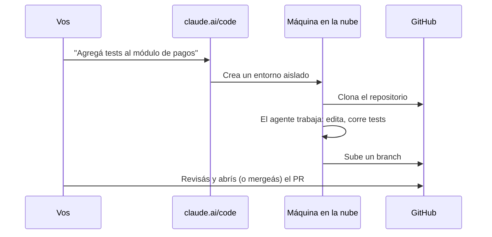

# Desarrollar con IA: Claude Code en terminal, escritorio, IDE y web

## 1. De autocompletar a delegar

Las herramientas de IA para programar pasaron por tres etapas, y conviene distinguirlas porque cambian **qué hace el desarrollador**:

| Etapa | Ejemplo de uso | Quién decide los pasos |
|---|---|---|
| **Autocompletado** | Sugiere la línea siguiente mientras escribís | Vos, línea por línea |
| **Chat** | Pegás código en una conversación, copiás la respuesta | Vos, y hacés de "puente" a mano |
| **Agente** | "Agregá validación a este endpoint y que pasen los tests" | El agente: lee archivos, edita, corre comandos, itera |

Un **agente de programación** es un modelo de lenguaje conectado a herramientas: leer y escribir archivos, buscar en el código, ejecutar comandos en una terminal. El modelo decide qué herramienta usar, ve el resultado y decide el paso siguiente, en un bucle, hasta terminar la tarea.



**Claude Code** es el agente de programación de Anthropic. Trabaja **sobre tu proyecto real** (tus archivos, tu git, tu terminal), no sobre fragmentos pegados en un chat.

## 2. Dónde corre Claude Code

Es el mismo agente con varias "caras". Todas comparten la configuración (`CLAUDE.md`, permisos, servidores MCP), así que podés pasar de una a otra.

| Superficie | Dónde se ejecuta el código | Para qué conviene |
|---|---|---|
| **Terminal (CLI)** | Tu máquina | La más completa; todos los comandos; automatización |
| **App de escritorio** (pestaña *Code*) | Tu máquina, o la nube | Interfaz gráfica, varias sesiones en paralelo |
| **Extensión de IDE** (VS Code, JetBrains) | Tu máquina | Ver diffs dentro del editor mientras trabajás |
| **Web** (claude.ai/code) y **app móvil** | Nube de Anthropic | Tareas que corren solas sobre un repo de GitHub, sin tu máquina prendida |

> Requisito común: Claude Code **no está incluido en el plan gratuito**. Se usa con una suscripción (Pro o superior) o con una API key de pago (ver el apunte de modelos y costos).

### 2.1 Terminal (CLI)

Instalación:

```bash
# macOS, Linux, WSL
curl -fsSL https://claude.ai/install.sh | bash

# Windows (PowerShell)
irm https://claude.ai/install.ps1 | iex

# Alternativas
brew install --cask claude-code          # Homebrew
winget install Anthropic.ClaudeCode       # WinGet
npm install -g @anthropic-ai/claude-code  # npm (Node 22+)
```

Uso: te parás en la carpeta del proyecto y lo lanzás.

```bash
cd mi-proyecto
claude
```

La primera vez pide iniciar sesión (con la cuenta de claude.ai o de la consola de API). A partir de ahí se conversa en lenguaje natural:

```text
> ¿qué hace este proyecto y cómo se corre?
> el test de login falla, encontrá por qué y arreglalo
> agregá paginación a GET /books, con tests
```

#### Atajos y comandos esenciales

| Escribís | Qué hace |
|---|---|
| `@src/app.ts` | Agrega ese archivo al contexto de forma explícita |
| `! npm test` | Corre el comando vos mismo; la salida queda en la conversación |
| `Esc` | Interrumpe lo que está haciendo el agente |
| `Esc Esc` o `/rewind` | Vuelve a un punto anterior (código y conversación) |
| `Shift+Tab` | Cambia de modo de permisos (ver 3.2) |
| `/init` | Genera un `CLAUDE.md` analizando el proyecto |
| `/model` | Cambia de modelo |
| `/effort` | Cambia el nivel de esfuerzo (`low` … `max`) |
| `/clear` | Conversación nueva (descarta el contexto) |
| `/compact` | Resume la conversación para liberar contexto |
| `/context` | Muestra cuánto contexto está ocupado y en qué |
| `/usage` (o `/cost`) | Consumo de la sesión / del plan |
| `/diff` | Muestra los cambios hechos |
| `/resume` | Retoma una conversación anterior |
| `/help` | Lista de comandos |

#### Modo no interactivo (*headless*)

Con `-p` Claude Code ejecuta un pedido y termina, sin conversación. Sirve para scripts y pipelines de CI:

```bash
claude -p "revisá los cambios de este branch y listá posibles bugs" \
       --allowedTools "Read,Grep,Glob"

git diff main | claude -p "escribí un mensaje de commit para este diff"
```

Para continuar la última conversación: `claude --continue`; una específica: `claude --resume <id>`.

### 2.2 App de escritorio

La app de Claude (macOS, Windows; Linux en beta) tiene una pestaña **Code** que trae Claude Code integrado: no hace falta instalar la CLI ni Node. Abrís una carpeta y trabajás igual que en la terminal, pero con interfaz gráfica: los diffs se ven coloreados, podés tener varias sesiones abiertas y elegir si cada una corre **en tu máquina**, **en la nube**, por **SSH** en otro servidor o dentro de **WSL**.

Es la opción más cómoda para quien no se lleva bien con la terminal.

### 2.3 Extensiones de IDE

#### VS Code

Funciona en VS Code 1.94 o posterior y en editores derivados (Cursor y otros *forks* de VS Code; en estos últimos se instala desde Open VSX).

**Instalación**

1. En VS Code, abrí la vista de extensiones (`Ctrl+Shift+X`).
2. Buscá **Claude Code** (publicada por Anthropic, identificador `anthropic.claude-code`) e instalala.
   Desde la terminal también se puede: `code --install-extension anthropic.claude-code`.
3. Abrí el panel de Claude con el ícono de la chispa (*Spark*), arriba a la derecha del editor (aparece con un archivo abierto) o en la barra lateral, o desde la paleta de comandos (`Ctrl+Shift+P` → "Claude Code").
4. La primera vez te pide iniciar sesión, con la misma cuenta que usarías en la terminal.

Antes de empezar, abrí **la carpeta del proyecto** (*File → Open Folder*), no un archivo suelto. El agente trabaja sobre la carpeta abierta y lee su `CLAUDE.md`.

**El ciclo de trabajo**

La diferencia con la terminal es dónde revisás los cambios. Cada edición propuesta aparece como un **diff dentro del editor**, con lo viejo y lo nuevo lado a lado. Ahí la aceptás o la rechazás, igual que revisarías un cambio de un compañero.



**Contexto desde el editor**

- **Selección**: si seleccionás líneas antes de escribir el pedido, Claude las toma como contexto. Por ejemplo, seleccionás una función y escribís "explicame esto" o "esto tiene un bug con fechas vacías".
- **`@archivo`**: mencionás archivos (con autocompletado) para sumarlos al contexto.
- **Varias conversaciones**: podés abrir más de una pestaña de Claude para tareas independientes.

**Plan y checkpoints**

- En modo plan, el plan se abre como un documento Markdown en el editor. Le agregás comentarios en línea y recién después lo aprobás.
- Cada paso deja un *checkpoint*. Si el agente se fue por mal camino, volvés a un punto anterior del código y de la conversación.

**Extensión o terminal integrada**

También podés correr `claude` en la terminal integrada de VS Code. Con la extensión instalada, la CLI se conecta sola al editor: recibe tu selección y el archivo activo, y muestra los diffs en VS Code. Desde una terminal externa, la conexión se hace con el comando `/ide`.

| | Panel de la extensión | `claude` en la terminal integrada |
|---|---|---|
| Revisión de cambios | Diff gráfico en el editor | Diff en el editor (conectada a VS Code) o en texto |
| Comandos disponibles | Los principales | Todos, incluido el atajo `!` |
| Curva de aprendizaje | Baja | Media |
| Ideal para | Empezar, trabajo diario | Usuarios avanzados, automatización |

Las dos comparten la configuración: `CLAUDE.md`, permisos y servidores MCP.

> Recomendación para la cursada: empezar con la extensión, porque ver el diff en el editor obliga a leer lo que cambió. Pasar a la terminal cuando haga falta algo que la extensión no tiene.

#### JetBrains

**JetBrains** (IntelliJ, WebStorm, PyCharm, etc.): plugin *Claude Code* del JetBrains Marketplace. Requiere tener la CLI instalada; muestra los diffs en el visor del IDE.

La CLI sigue siendo la más completa (algunos comandos y el atajo `!` son sólo de terminal), pero para el día a día la extensión es muy práctica.

### 2.4 Web y móvil: claude.ai/code

Acá cambia el modelo de ejecución: **el código no corre en tu máquina**, sino en una máquina virtual en la nube de Anthropic.



- Requiere conectar la cuenta de **GitHub**.
- La tarea sigue corriendo aunque cierres la notebook; se puede lanzar desde el celular (app de Claude, pestaña *Code*).
- Varias tareas en paralelo, cada una en su entorno.
- El resultado se integra con el flujo normal de **branch + pull request**: vos revisás el PR como revisarías el de un compañero.

Es ideal para tareas bien definidas e independientes ("actualizá esta dependencia y arreglá lo que se rompa", "escribí los tests que faltan en `utils/`"). Para trabajo exploratorio, donde querés ir mirando paso a paso, es más cómodo trabajar en local.

## 3. Cómo se controla al agente

### 3.1 `CLAUDE.md`: la memoria del proyecto

Archivo Markdown en la raíz del repositorio que Claude Code **lee al empezar cada sesión**. Ahí van las cosas que no querés repetir:

```markdown
# CLAUDE.md
## Comandos
- `npm test` — correr antes de dar algo por terminado
- `npm run lint`
## Convenciones
- TypeScript estricto, sin `any`
- Endpoints nuevos: validación de body + tests feliz y de error
## No hacer
- No agregar dependencias sin preguntar
- No tocar `migrations/` existentes
```

`/init` genera una primera versión; `/memory` permite editarlo. Hay niveles: uno personal (en tu usuario, vale para todos tus proyectos), uno del proyecto (va al repo) y uno local (`CLAUDE.local.md`, fuera de git).

> Un `CLAUDE.md` bueno es **corto y concreto**. Se carga entero en cada sesión: cada línea cuesta tokens y compite por la atención del modelo.

### 3.2 Permisos

El agente puede ejecutar comandos en tu máquina, así que los permisos importan. Modos principales (se alternan con `Shift+Tab` o con `--permission-mode`):

| Modo | Comportamiento |
|---|---|
| **default** | Pide permiso antes de editar archivos y correr comandos |
| **acceptEdits** | Edita archivos y corre comandos comunes de archivos (`mkdir`, `mv`, `cp`…) sin preguntar; el resto de los comandos sigue pidiendo permiso |
| **plan** | Sólo lee y propone un plan; no modifica nada |
| **auto** | Decide solo, con un clasificador que frena las acciones riesgosas |
| **bypassPermissions** | No pregunta nada. Sólo en entornos descartables (contenedor, VM) |

Además se pueden fijar reglas permanentes en `.claude/settings.json`, por ejemplo permitir siempre `npm test` y prohibir siempre `rm -rf` o leer `.env`:

```json
{
  "permissions": {
    "allow": ["Bash(npm test *)", "Bash(npm run lint)"],
    "deny":  ["Read(./.env)", "Bash(rm -rf *)"]
  }
}
```

### 3.3 Modo plan

Para cualquier cambio no trivial, el flujo recomendado es **planificar primero**:

1. Entrás en modo plan (`Shift+Tab` hasta *plan mode*, o `/plan`).
2. Describís el objetivo. El agente explora el código y propone un plan.
3. Lo corregís ("no uses una librería nueva", "empezá por los tests").
4. Aprobás y recién ahí implementa.

Corregir un plan es barato; corregir 400 líneas generadas en la dirección equivocada, no.

### 3.4 Extensiones del agente

Sin entrar en detalle, conviene saber que existen:

- **Servidores MCP** (*Model Context Protocol*): conectan el agente con sistemas externos (una base de datos, GitHub, Jira, la documentación de una librería). Se agregan con `claude mcp add`.
- **Subagentes**: agentes especializados (por ejemplo, un "revisor de seguridad") a los que el agente principal delega partes del trabajo, con su propio contexto.
- **Skills**: paquetes de instrucciones para tareas repetidas (cómo desplegar, cómo escribir una migración en *este* proyecto), que el agente carga cuando las necesita.
- **Hooks**: comandos que se ejecutan automáticamente en ciertos eventos, como correr el formateador después de cada edición.

## 4. Elegir modelo y esfuerzo dentro de Claude Code

```bash
claude --model sonnet        # al arrancar
```

```text
/model opus                  # durante la sesión
/effort high
```

Se usan alias (`fable`, `opus`, `sonnet`, `haiku`) que apuntan a la versión vigente de cada familia. Existe también `opusplan`: usa Opus para planificar y Sonnet para ejecutar. El detalle de qué modelo conviene y cuánto cuesta cada uno está en el apunte siguiente.

**Modo rápido** (`/fast`): el mismo modelo generando más rápido, a cambio de costar más. Útil cuando estás esperando en vivo una respuesta; innecesario para tareas que dejás corriendo.

## 5. Riesgos y límites

Usar un agente no elimina la responsabilidad del desarrollador; la concentra en la revisión.

- **Código plausible pero incorrecto.** El agente produce código que compila, se ve bien y pasa los tests que él mismo escribió. Los errores suelen estar en lo que nadie especificó: validaciones, casos borde, concurrencia, permisos.
- **Seguridad.** Un agente con permisos amplios puede borrar archivos, exponer secretos o instalar dependencias dudosas. Permisos mínimos, secretos fuera del repo, y cuidado con pedirle que procese contenido externo (una página web, un issue) que podría contener instrucciones maliciosas (*prompt injection*).
- **Dependencias inventadas.** A veces sugiere paquetes que no existen o están abandonados. Verificar cada dependencia nueva.
- **Contexto que se degrada.** En sesiones muy largas el modelo pierde precisión. `/clear` entre tareas distintas, y `CLAUDE.md` para lo que tiene que persistir.
- **Dependencia del desarrollador.** Si no entendés el código que se generó, no lo vas a poder mantener ni depurar. Pedile que te lo explique; preguntale por qué eligió esa solución y no otra.

> La pregunta para cada diff no es "¿anda?", sino "¿lo habría aprobado si lo hubiera escrito un compañero?".
