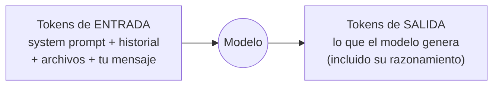
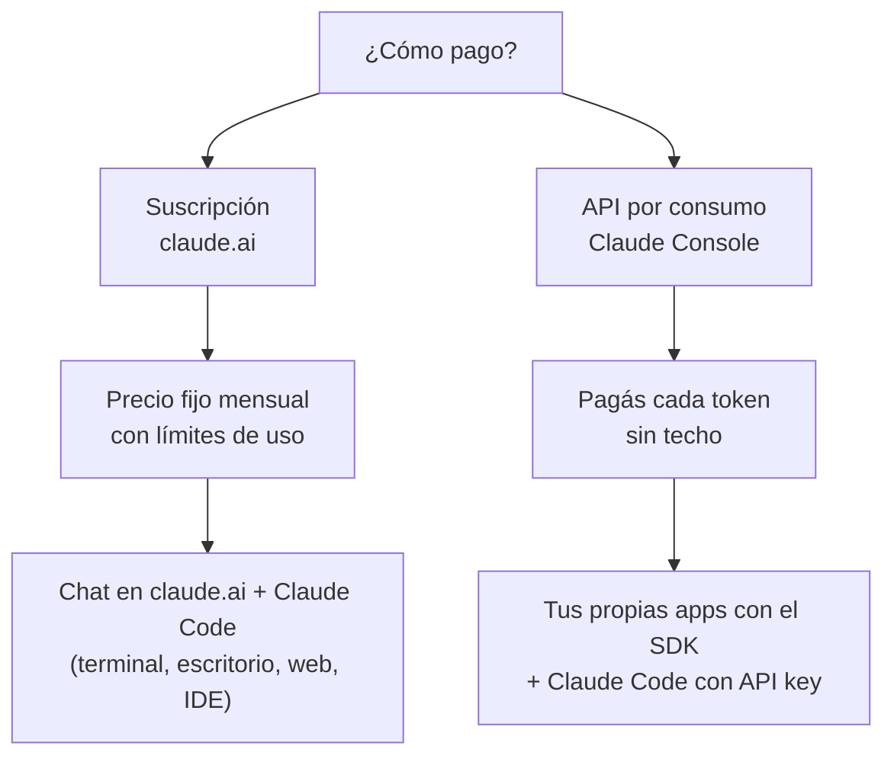

# Modelos, tokens y costos

Para usar IA en desarrollo con criterio hay que entender tres cosas: **qué es un token** (la unidad con la que se mide y se cobra todo), **qué modelos hay** (y por qué no conviene usar siempre el más grande) y **cómo se paga** (suscripción o consumo por API).

> Los precios y modelos de este apunte corresponden a noviembre de 2026. Cambian seguido: antes de tomar una decisión de costos, verificá en la página oficial de precios.

## 1. Tokens

### 1.1 Qué es un token

Un modelo de lenguaje no lee caracteres ni palabras: lee **tokens**, fragmentos de texto que salen de un vocabulario fijo (el *tokenizer*). Una palabra común puede ser un token; una palabra rara, un identificador de código o una palabra en español suelen partirse en varios.

```text
"Programación IV"   →  ["Program", "ación", " IV"]          ≈ 3 tokens
"getUserById"       →  ["get", "User", "By", "Id"]           ≈ 4 tokens
"   "               →  espacios e indentación también cuentan
```

(La partición exacta depende del modelo; el ejemplo es ilustrativo.)

Reglas prácticas para estimar:

- En inglés, ~**4 caracteres por token**; en español y en código, algo menos (más tokens por el mismo texto).
- Una página de apunte (~500 palabras) ronda los **700–900 tokens**.
- Un archivo de código de 200 líneas puede ser **2.000–3.000 tokens**.

Para contar exacto no se adivina: la API tiene un endpoint de conteo (`/v1/messages/count_tokens`). Herramientas de otros proveedores (como `tiktoken`) usan **otro tokenizer** y dan números incorrectos para Claude.

### 1.2 Entrada y salida

Cada llamada a un modelo tiene dos partes que se miden y cobran por separado:



- **Entrada (input)**: todo lo que le mandás. Ojo: en una conversación, **cada turno reenvía todo el historial**. El turno 20 de una charla paga de nuevo la entrada de los 19 anteriores.
- **Salida (output)**: lo que genera. Es **unas 5 veces más cara** que la entrada, y además es más lenta (se genera token a token).

Esto explica por qué un agente como Claude Code consume mucho más que un chat: en cada paso relee archivos, salidas de comandos y todo lo que vino antes.

### 1.3 Ventana de contexto

La **ventana de contexto** es el máximo de tokens (entrada + salida) que el modelo puede considerar en una llamada. Los modelos actuales de Claude tienen **1 millón de tokens** de contexto (Haiku 4.5, de la generación anterior, tiene 200 mil).

Un millón de tokens es mucho (un repositorio mediano entero), pero tiene dos costos:

1. **Plata**: cada token de entrada se paga en cada llamada.
2. **Calidad**: con mucho contexto irrelevante, el modelo se distrae. Más contexto no es mejor contexto.

Por eso las herramientas lo administran: Claude Code **compacta** la conversación (resume lo viejo) cuando se acerca al límite, y vos podés forzarlo con `/compact` o empezar de cero con `/clear`.

### 1.4 Caché de prompts

Si muchas llamadas empiezan con el mismo prefijo (el mismo system prompt, los mismos archivos), ese prefijo se puede **cachear**: la primera vez se paga un poco más por escribirlo en caché y las siguientes se lee mucho más barato.

| Operación | Costo relativo al precio de entrada |
|---|---|
| Escritura en caché (dura 5 min) | 1,25× |
| Escritura en caché (dura 1 hora) | 2× |
| Lectura de caché | ~0,1× (en los modelos más nuevos, menos: 0,05× en Opus 5.5 y Sonnet 5.5, 0,025× en Fable 5.2) |

Con caché de 5 minutos, **ya con dos llamadas** sale más barato que sin caché (1,25 + 0,1 = 1,35 contra 2). Claude Code usa caché automáticamente; en tus propias apps con la API, lo activás vos.

## 2. Modelos

### 2.1 Las familias

Anthropic organiza sus modelos en familias según el balance capacidad / velocidad / precio:

| Familia | Perfil | Cuándo usarla |
|---|---|---|
| **Fable** | El más capaz | Problemas muy difíciles, tareas largas y autónomas, arquitectura |
| **Opus** | Muy capaz, más económico que Fable | Programación compleja, agentes; es el modelo por defecto en muchas herramientas |
| **Sonnet** | Rápido y capaz | Programación diaria, la mayoría de las tareas |
| **Haiku** | Muy rápido y muy barato | Tareas simples y de alto volumen: clasificar, extraer, resumir, subagentes |

### 2.2 Modelos actuales y precios por API

Precios en dólares por **millón de tokens** (MTok), API directa de Anthropic:

| Modelo | ID para la API | Contexto | Entrada | Salida |
|---|---|---|---:|---:|
| Claude Fable 5.2 | `claude-fable-5-2` | 1M | $8 | $40 |
| Claude Opus 5.5 | `claude-opus-5-5` | 1M | $4 | $20 |
| Claude Sonnet 5.5 | `claude-sonnet-5-5` | 1M | $2 | $10 |
| Claude Haiku 5.5 | `claude-haiku-5-5` | 1M | $0,10* | $0,50* |

\* Haiku 5.5 tiene precio escalonado: $0,10 / $0,50 con prompts de hasta 100K tokens, y $0,50 / $2,50 por encima. Además usa un tokenizer más nuevo, que cuenta el mismo texto como ~30% más tokens.

Siguen disponibles modelos anteriores (Fable 5.1, Opus 5, Sonnet 5, Opus 4.x, Haiku 4.5, etc.) para quien los necesite por compatibilidad; para proyectos nuevos se usan los actuales.

Observá la escala: entre Haiku 5.5 y Fable 5.2 hay **80 veces** de diferencia en precio. Elegir modelo es una decisión de ingeniería, no de gusto.

### 2.3 Razonamiento (*thinking*) y esfuerzo

Los modelos actuales **razonan antes de responder** (*adaptive thinking*): deciden cuánto pensar según la dificultad. Ese razonamiento **se cobra como tokens de salida**, aunque no lo veas completo.

El control principal es el **esfuerzo** (*effort*): `low`, `medium`, `high`, `xhigh`, `max`. Más esfuerzo = respuestas más cuidadosas, más tokens, más tiempo. Regla práctica:

- `low` para tareas simples o de alto volumen.
- `medium` / `high` para la mayoría del trabajo.
- `xhigh` / `max` cuando equivocarse sale caro (un bug sutil, un diseño importante).

Muchas veces, **un modelo grande con esfuerzo bajo** rinde igual o mejor que uno chico con esfuerzo alto. Se decide midiendo.

### 2.4 Cómo elegir: un ejemplo

Supongamos una app que resume reseñas de usuarios: 50.000 reseñas por mes, ~400 tokens de entrada y ~100 de salida cada una.

```text
Entrada: 50.000 × 400 = 20 MTok
Salida:  50.000 × 100 =  5 MTok
```

| Modelo | Entrada | Salida | Total/mes |
|---|---:|---:|---:|
| Fable 5.2 | 20 × $8 = $160 | 5 × $40 = $200 | **$360** |
| Opus 5.5 | 20 × $4 = $80 | 5 × $20 = $100 | **$180** |
| Sonnet 5.5 | 20 × $2 = $40 | 5 × $10 = $50 | **$90** |
| Haiku 5.5 | 20 × $0,10 = $2 | 5 × $0,50 = $2,50 | **$4,50** |

Para resumir reseñas, Haiku probablemente alcance. Para revisar código de seguridad, no ahorrarías en modelo. El procedimiento correcto: armar un set de 30–50 casos reales, correrlo con dos o tres modelos y comparar calidad contra costo.

### 2.5 Otros descuentos

- **Batch API**: si las llamadas no necesitan respuesta inmediata (procesar 50.000 reseñas de noche), se mandan en lote y cuestan **50% menos**.
- **Caché de prompts**: lo visto en 1.4.
- **Modo rápido** (*fast mode*, en Fable 5.2 y en Opus 5.5 y anteriores): el mismo modelo generando más rápido, al **doble de precio**. Es lo inverso de un descuento: se paga velocidad.

## 3. Formas de pago

Hay dos mundos que conviene no confundir:



### 3.1 Suscripción

Pagás un monto fijo por mes y usás Claude (chat y Claude Code) **dentro de límites de uso** que se renuevan periódicamente. Si los agotás, esperás a que se renueven (o, según el plan, comprás uso extra).

| Plan | Precio (USD) | Claude Code | Uso relativo |
|---|---|---|---|
| Free | $0 | **No incluido** | — |
| Pro | $20/mes (o $17/mes pagando el año) | Sí | Base |
| Max | $100/mes | Sí | 5× Pro |
| Ultra | $200/mes | Sí | 10× Pro |
| Team (asiento estándar) | $25/mes ($20 anual) por persona | Sí | Más que Pro |
| Team (asiento premium) | $125/mes ($100 anual) por persona | Sí | 5× asiento estándar |
| Enterprise | $20 por asiento/mes (anual) + uso a precio de API | Sí | Según consumo |

Los límites funcionan con dos ventanas: una **sesión de 5 horas** y un **límite semanal**, compartidos entre el chat de claude.ai y Claude Code (Ultra no tiene límite de 5 horas en cuentas verificadas, sólo el semanal). Max y Ultra incluyen Fable hasta la mitad del límite semanal, más un crédito mensual de API ($100 y $200). Al llegar al límite se puede esperar, subir de plan o activar créditos de uso a precio de API. Anthropic no publica cifras exactas en tokens; el uso real depende del modelo elegido (Opus consume el cupo más rápido que Sonnet), del tamaño del contexto y del esfuerzo. Dentro de Claude Code, `/usage` muestra cuánto llevás consumido.

Para instituciones existe **Claude for Education** (se contrata institucionalmente, sin precio público). No hay, por ahora, descuento individual para estudiantes.

**Ventaja**: costo predecible; para uso diario intensivo de Claude Code suele salir mucho más barato que pagar los mismos tokens por API.
**Desventaja**: no sirve para que *tu app* llame al modelo. La suscripción es para que **vos** uses Claude, no para tus usuarios.

### 3.2 API por consumo (Claude Console)

Creás una cuenta en la consola de desarrolladores, cargás crédito y generás una **API key**. Cada llamada se cobra según los tokens, con los precios de la sección 2.2.

- Es **obligatoria** para que tu aplicación use Claude (como el endpoint `/suggest` del apunte siguiente).
- También podés usar Claude Code con una API key: pagás exactamente lo que consumís. Para uso esporádico puede convenir; para uso diario intenso, la suscripción suele ser más barata.
- La consola permite poner **límites de gasto** por mes y por espacio de trabajo. Ponelos siempre: un bucle mal programado que llama a la API puede gastar mucho en minutos.

### 3.3 Nubes de terceros

Las empresas que ya trabajan con una nube suelen consumir los mismos modelos a través de **Amazon Bedrock**, **Google Cloud** (Agent Platform, antes Vertex AI) o **Microsoft Foundry**, facturados junto con el resto de su infraestructura. Claude Code también puede configurarse para usar esos proveedores.

### 3.4 ¿Qué me conviene?

| Situación | Opción razonable |
|---|---|
| Quiero aprender y programar con Claude Code algunas horas por semana | Suscripción Pro |
| Uso Claude Code todo el día, con tareas largas | Suscripción Max |
| Equipo de desarrollo en una empresa | Plan Team / Enterprise, o API con la nube de la empresa |
| Mi app tiene que llamar a Claude | API (Console o nube), siempre |
| Uso esporádico, pocas veces al mes | API key con límite de gasto |

> **Seguridad de la API key**: es una credencial que gasta tu plata. Nunca en el código, nunca en un repositorio, nunca pegada en un chat. Variable de entorno o gestor de secretos.
