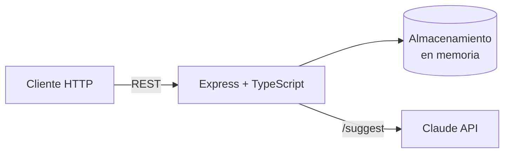
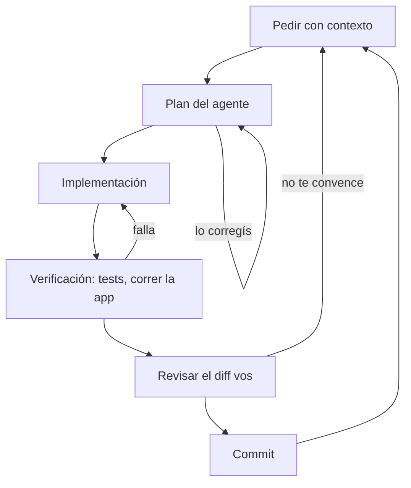

# Desarrollo de una app simple con Claude Code, paso a paso

En los dos apuntes anteriores vimos qué es Claude Code, dónde corre, qué modelos usa y cuánto cuesta. Acá lo ponemos a trabajar: vamos a construir **de cero** una API chica en TypeScript + Express, con tests, y al final le agregamos una función que a su vez llama a Claude por API.

Lo importante no es la app (es deliberadamente simple), sino **el método**: cómo se le pide trabajo a un agente, cómo se revisa lo que hace y dónde sigue siendo indispensable el criterio del desarrollador.

## 1. La app: "Tareas con subtareas sugeridas"

Una API REST de tareas:

| Método | Ruta | Qué hace |
|---|---|---|
| `GET` | `/tasks` | Lista las tareas |
| `POST` | `/tasks` | Crea una tarea `{ title }` |
| `PATCH` | `/tasks/:id` | Marca `done` / cambia el título |
| `DELETE` | `/tasks/:id` | Borra una tarea |
| `POST` | `/tasks/:id/suggest` | **Pide a Claude** 3–5 subtareas para esa tarea |

Las cuatro primeras son CRUD clásico (lo que ya sabemos hacer a mano). La quinta es la parte "con IA adentro": la app misma consume un modelo.



## 2. El ciclo de trabajo con un agente

Antes de tocar el teclado, el esquema mental. Con un agente **no se escribe "todo de una"**: se itera en ciclos cortos, y cada ciclo termina con algo verificable.



> La regla de oro: **el agente escribe, vos sos responsable.** Nada entra al repositorio sin que hayas leído el diff.

## 3. Paso 0 — Preparar el proyecto

```bash
mkdir tareas-ia && cd tareas-ia
git init
claude
```

Arrancar con `git init` **antes** de la primera instrucción no es un detalle: git es tu red de seguridad. Cada paso bueno termina en un commit; si el agente rompe algo, volvés atrás con `git diff` / `git restore`.

Ya dentro de Claude Code, el primer prompt:

```text
Quiero crear una API REST en TypeScript con Express para gestionar tareas.
Requisitos:
- Node 22, TypeScript estricto, ESM.
- Almacenamiento en memoria (un Map), sin base de datos por ahora.
- Tests con Vitest y Supertest.
- Scripts npm: dev, build, test.
Primero proponé la estructura de carpetas y las dependencias; no escribas código todavía.
```

Fijate en tres cosas del prompt:

1. **Contexto técnico explícito** (versión, ESM, librerías). Si no lo das, el agente elige por vos, y quizás elija otra cosa.
2. **Restricción de alcance** ("sin base de datos por ahora"). Evita que "se entusiasme".
3. **"No escribas código todavía"**. Primero el plan. Para esto también existe el **modo plan** (`Shift+Tab` hasta ver *plan mode*), en el que el agente sólo puede leer y proponer.

Una respuesta típica:

```text
tareas-ia/
├── src/
│   ├── app.ts          ← crea y exporta la app Express (sin listen)
│   ├── server.ts       ← importa app y hace listen
│   ├── tasks/
│   │   ├── store.ts    ← Map<string, Task> + funciones CRUD
│   │   └── routes.ts   ← router /tasks
│   └── types.ts
├── test/
│   └── tasks.test.ts
├── package.json
└── tsconfig.json
```

Separar `app.ts` de `server.ts` es una buena decisión (permite testear con Supertest sin abrir un puerto). Si el plan no te gusta, **es el momento barato de decirlo**: corregir un plan cuesta una línea; corregir 300 líneas de código, mucho más.

## 4. Paso 1 — `CLAUDE.md`: la memoria del proyecto

Aceptado el plan, le pedimos que lo implemente. Y enseguida corremos:

```text
/init
```

`/init` analiza el repositorio y genera un `CLAUDE.md` en la raíz: un archivo Markdown que Claude Code **lee automáticamente al inicio de cada sesión**. Es la forma de no tener que repetir el contexto todos los días. Lo editamos a mano para dejar las reglas que nos importan:

```markdown
# CLAUDE.md

## Comandos
- `npm run dev`   — servidor con recarga
- `npm test`      — Vitest (correr SIEMPRE antes de dar una tarea por terminada)
- `npm run build` — tsc

## Convenciones
- TypeScript estricto, sin `any`.
- Validar el body de cada request; responder 400 con `{ error }` si es inválido.
- Cada endpoint nuevo lleva al menos un test feliz y uno de error.
- No agregar dependencias sin preguntar.
```

> `CLAUDE.md` va al repositorio (lo comparte todo el equipo). Para preferencias personales existe `CLAUDE.local.md`, que se agrega al `.gitignore`.

## 5. Paso 2 — El CRUD

```text
Implementá el CRUD de /tasks según el plan. Escribí los tests primero,
mostrame que fallan, y después implementá hasta que pasen.
```

Pedir **tests primero** tiene un efecto concreto con agentes: les das un criterio objetivo de "terminado". El agente corre `npm test`, ve rojo, implementa, vuelve a correr, ve verde. Ese bucle lo hace solo; vos mirás.

Mientras trabaja, Claude Code te va a pedir permiso para acciones sensibles:

```text
Claude wants to run: npm install express
  1. Yes
  2. Yes, and don't ask again for npm install
  3. No, and tell Claude what to do differently
```

Aceptar "no volver a preguntar" para `npm test` o `npm install` es razonable; para comandos destructivos, no.

Un fragmento de lo que produce (`src/tasks/routes.ts`):

```typescript
import { Router } from "express";
import { createTask, listTasks, updateTask, deleteTask } from "./store.js";

export const tasksRouter = Router();

tasksRouter.get("/", (_req, res) => {
  res.json(listTasks());
});

tasksRouter.post("/", (req, res) => {
  const { title } = req.body ?? {};
  if (typeof title !== "string" || title.trim() === "") {
    return res.status(400).json({ error: "title es obligatorio" });
  }
  res.status(201).json(createTask(title.trim()));
});

tasksRouter.patch("/:id", (req, res) => {
  const task = updateTask(req.params.id, req.body);
  if (!task) return res.status(404).json({ error: "no existe" });
  res.json(task);
});

tasksRouter.delete("/:id", (req, res) => {
  if (!deleteTask(req.params.id)) return res.status(404).json({ error: "no existe" });
  res.status(204).end();
});
```

Y un test (`test/tasks.test.ts`):

```typescript
import request from "supertest";
import { describe, it, expect } from "vitest";
import { app } from "../src/app.js";

describe("POST /tasks", () => {
  it("crea una tarea", async () => {
    const res = await request(app).post("/tasks").send({ title: "Estudiar" });
    expect(res.status).toBe(201);
    expect(res.body).toMatchObject({ title: "Estudiar", done: false });
  });

  it("rechaza un título vacío", async () => {
    const res = await request(app).post("/tasks").send({ title: "  " });
    expect(res.status).toBe(400);
  });
});
```

### 5.1 La revisión: acá trabajás vos

El agente dice "listo, 8 tests pasan". **No es suficiente.** Revisamos el diff (`git diff`, o el visor de diffs de la extensión de VS Code / app de escritorio) buscando lo que los tests no cubren. En este caso encontramos:

```typescript
tasksRouter.patch("/:id", (req, res) => {
  const task = updateTask(req.params.id, req.body);   // ← req.body sin validar
```

`PATCH` pasa el body entero al store: alguien puede mandar `{ "id": "otro" }` y pisar el id, o `{ "done": "sí" }` con un string. El `CLAUDE.md` decía "validar el body de cada request", y el agente lo cumplió en `POST` pero no en `PATCH`. Se lo señalamos:

```text
En PATCH /tasks/:id el body no se valida: se puede pisar el id y `done`
acepta cualquier tipo. Permití sólo `title` (string no vacío) y `done`
(boolean), y agregá tests para ambos casos inválidos.
```

> Este es el patrón más común con agentes: el código **anda** y los tests **pasan**, pero hay un caso que nadie pidió probar. Los agentes son buenos cumpliendo criterios explícitos; los implícitos siguen siendo tu trabajo.

Con el arreglo y los tests en verde:

```bash
git add -A && git commit -m "CRUD de tareas con validación y tests"
```

(También se le puede pedir a Claude que haga el commit; escribe mensajes de commit razonables. Lo importante es que el diff ya lo leíste.)

## 6. Paso 3 — La parte "con IA adentro": `/suggest`

Ahora sí, la app llama a un modelo. Primero, el prompt al agente:

```text
Agregá POST /tasks/:id/suggest: usa el SDK oficial @anthropic-ai/sdk para
pedirle a Claude entre 3 y 5 subtareas concretas para el título de la tarea.
- La API key sale de la variable de entorno ANTHROPIC_API_KEY (nunca en el código).
- La respuesta tiene que ser JSON validado: { subtasks: string[] }.
- Encapsulá la llamada en src/ai/suggest.ts para poder mockearla en los tests.
- Los tests NO deben llamar a la API real.
```

El último punto importa: un test que llama a la API real es **lento, cuesta plata y no es determinista**. Se mockea.

El módulo resultante (`src/ai/suggest.ts`):

```typescript
import Anthropic from "@anthropic-ai/sdk";

const client = new Anthropic(); // lee ANTHROPIC_API_KEY del entorno

export async function suggestSubtasks(title: string): Promise<string[]> {
  const response = await client.messages.create({
    model: "claude-opus-5-5",
    max_tokens: 1024,
    system:
      "Sos un asistente de productividad. Respondé SOLO con un JSON de la forma " +
      '{"subtasks": ["...", "..."]}, con entre 3 y 5 subtareas breves y accionables, en español.',
    messages: [{ role: "user", content: `Tarea: ${title}` }],
  });

  if (response.stop_reason === "refusal") {
    throw new Error("El modelo rechazó la solicitud");
  }

  const text = response.content
    .filter((b) => b.type === "text")
    .map((b) => b.text)
    .join("");

  const data = JSON.parse(text);
  if (!Array.isArray(data.subtasks) || !data.subtasks.every((s: unknown) => typeof s === "string")) {
    throw new Error("Respuesta del modelo con formato inválido");
  }
  return data.subtasks.slice(0, 5);
}
```

Puntos a notar, que conectan con el apunte de modelos y costos:

- **`model`** es un string que elige el modelo (y por lo tanto el precio). Para una tarea tan acotada se podría usar uno más barato; lo medimos más abajo.
- **`max_tokens`** es un tope de tokens **de salida**: si se alcanza, la respuesta se corta. Para tres a cinco frases, 1024 sobra.
- **`system`** es el *system prompt*: instrucciones fijas que no dependen del usuario.
- **Nunca confiar en la salida del modelo**: se parsea y se valida como cualquier input externo. (La API también ofrece *structured outputs*, que garantizan que la respuesta cumpla un JSON Schema; para la clase alcanza con validar a mano.)

La ruta y su test con mock:

```typescript
// src/tasks/routes.ts (agregado)
import { suggestSubtasks } from "../ai/suggest.js";

tasksRouter.post("/:id/suggest", async (req, res) => {
  const task = getTask(req.params.id);
  if (!task) return res.status(404).json({ error: "no existe" });
  try {
    res.json({ subtasks: await suggestSubtasks(task.title) });
  } catch {
    res.status(502).json({ error: "no se pudieron generar sugerencias" });
  }
});
```

```typescript
// test/suggest.test.ts
import { vi, it, expect } from "vitest";
vi.mock("../src/ai/suggest.js", () => ({
  suggestSubtasks: vi.fn().mockResolvedValue(["Leer el apunte", "Hacer un resumen", "Repasar"]),
}));
import request from "supertest";
import { app } from "../src/app.js";

it("devuelve subtareas sugeridas", async () => {
  const { body: t } = await request(app).post("/tasks").send({ title: "Preparar el parcial" });
  const res = await request(app).post(`/tasks/${t.id}/suggest`);
  expect(res.status).toBe(200);
  expect(res.body.subtasks).toHaveLength(3);
});
```

Prueba manual contra la API real (con la key en el entorno, nunca en el repo):

```bash
export ANTHROPIC_API_KEY=...        # o un archivo .env que está en .gitignore
npm run dev
curl -s -X POST localhost:3000/tasks -H 'content-type: application/json' \
     -d '{"title":"Preparar el parcial de Programación IV"}'
curl -s -X POST localhost:3000/tasks/<id>/suggest
```

```json
{ "subtasks": [
  "Listar los temas que entran en el parcial",
  "Releer los apuntes de cada unidad",
  "Rehacer los ejemplos de código de clase",
  "Armar un resumen de una carilla por tema"
] }
```

## 7. Cuánto costó cada cosa

Dos costos distintos, que conviene no mezclar:

**a) El costo de *desarrollar* con Claude Code.** Si usás una suscripción (Pro/Max), está incluido en el plan, con límites de uso. Con API key, `/usage` (alias `/cost`) muestra el gasto de la sesión; con suscripción, cuánto del cupo llevás usado. Una sesión como la de este apunte (plan + CRUD + tests + revisión + feature IA) mueve típicamente varios cientos de miles de tokens de entrada (el agente relee archivos y salidas de comandos en cada paso, buena parte desde caché) y decenas de miles de salida.

**b) El costo de *operar* la app**, es decir, cada llamada a `/suggest`. Esto se calcula con precisión. Una llamada típica:

| | Tokens | Opus 5.5 ($4 / $20 por MTok) | Haiku 5.5 ($0,10 / $0,50 por MTok) |
|---|---:|---:|---:|
| Entrada (system + título) | ~90 | $0,00036 | $0,000009 |
| Salida (JSON con 4 subtareas) | ~70 | $0,00140 | $0,000035 |
| **Total por llamada** | | **≈ $0,0018** | **≈ $0,00004** |
| **10.000 llamadas/mes** | | **≈ $18** | **≈ $0,44** |

> Estos números son un piso. Los dos modelos **razonan antes de responder**: en Opus 5.5 el razonamiento no se puede desactivar, y en Haiku 5.5 está activo por defecto. Esos tokens se cobran como salida. Para una tarea así de simple conviene bajar el esfuerzo (`output_config: { effort: "low" }`) y mirar `response.usage.output_tokens` en llamadas reales.

Para *esta* tarea (generar cuatro frases simples), la diferencia de calidad entre modelos es chica y la de precio es de ~40 veces. Es exactamente el tipo de decisión que se toma **midiendo**: probar los dos modelos con 20–30 títulos reales y comparar. Si Haiku alcanza, se cambia una línea:

```typescript
model: "claude-haiku-5-5",
```

> Los tokens reales de cada llamada vienen en la respuesta (`response.usage.input_tokens`, `response.usage.output_tokens`). En una app en producción conviene **loguearlos**: es la única forma de saber cuánto cuesta cada funcionalidad.

## 8. Qué hizo el agente y qué hicimos nosotros

| Lo hizo Claude Code | Lo hicimos nosotros |
|---|---|
| Proponer estructura y dependencias | Aceptar/corregir el plan |
| Escribir código y tests | Definir requisitos y restricciones |
| Correr tests y arreglar hasta verde | Leer el diff y encontrar el `PATCH` sin validar |
| Generar `CLAUDE.md` inicial | Escribir las reglas que importan |
| Integrar el SDK de Claude | Decidir que los tests no llamen a la API real |
| Escribir mensajes de commit | Decidir el modelo según costo medido |

La columna de la derecha es corta pero es la que separa una app que "anda en la demo" de una que se puede mantener.

## 9. Buenas prácticas que salen de este ejemplo

1. **Git desde el minuto cero**, commit después de cada ciclo verde.
2. **Plan antes que código** en todo lo que no sea trivial (modo plan o "no escribas código todavía").
3. **Pedidos chicos y verificables.** "Hacé el CRUD con tests" funciona; "hacé la app completa" produce mucho código difícil de revisar.
4. **Tests como criterio de terminado.** El agente itera solo contra ellos.
5. **`CLAUDE.md` corto y concreto**: comandos, convenciones, prohibiciones. No una novela.
6. **`/clear` entre tareas no relacionadas.** El contexto acumulado cuesta tokens y distrae al modelo.
7. **Secretos fuera del código y del chat**: variables de entorno, `.env` en `.gitignore`.
8. **Leer el diff siempre.** Especialmente validaciones, manejo de errores, seguridad y lo que *no* está.
