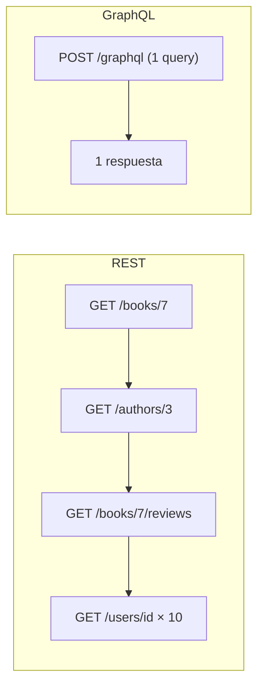
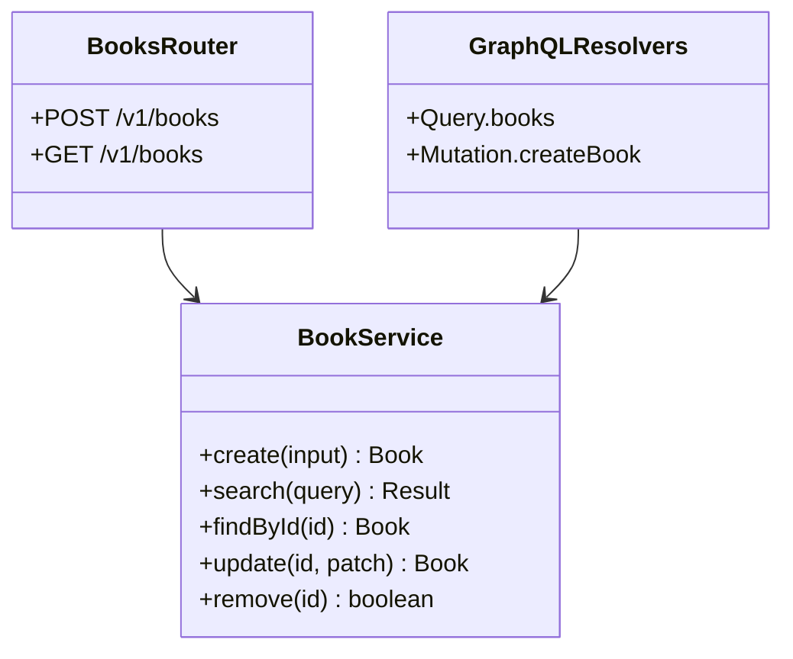

# GraphQL: otra forma de exponer la misma API (TypeScript + Express + GraphQL Yoga)

## 1. El problema que ataca

Nuestra API REST tiene el contrato cerrado: cada endpoint decide qué devuelve. Eso genera dos fricciones concretas.

### 1.1 Over-fetching

La pantalla de inicio sólo muestra **título y autor**. Pero `GET /v1/books` devuelve el libro entero:

```json
{ "id": "...", "title": "Rayuela", "author": "Cortázar", "year": 1963,
  "isbn": "...", "synopsis": "… 2 KB de texto …", "coverUrl": "...",
  "publisher": { "..." }, "stock": 12 }
```

Con 20 libros por página, se transfieren decenas de KB para pintar dos líneas de texto. En una conexión móvil, se nota.

### 1.2 Under-fetching (el problema N+1 del cliente)

La pantalla de detalle muestra el libro, su autor con biografía, y sus reseñas con el nombre de cada usuario:

```text
GET /v1/books/7                 → 1 request
GET /v1/authors/3               → 1 request
GET /v1/books/7/reviews         → 1 request
GET /v1/users/{id} × 10         → 10 requests
                                 ─────────────
                                   13 requests en cascada
```

Y son **en cascada**: hasta que no vuelve `/books/7` no sabés qué autor pedir. La latencia se suma.

### 1.3 La respuesta de REST, y su límite

REST tiene soluciones para esto:

```text
GET /v1/books?fields=title,author           ← sparse fieldsets
GET /v1/books/7?include=author,reviews.user ← inclusión de relaciones
```

Funcionan. El problema es que cada API inventa su propia sintaxis, hay que implementarla a mano endpoint por endpoint, y la documentación de qué combinaciones son válidas se vuelve inmanejable. **GraphQL toma esa idea y la convierte en el modelo central**, con un lenguaje de consulta definido y un esquema tipado que lo describe.

### 1.4 Cómo se ve

Una sola request, una sola ida y vuelta, exactamente los campos pedidos:

```graphql
query DetalleDeLibro {
  book(id: "7") {
    title
    year
    author { name bio }
    reviews(first: 10) {
      rating
      text
      user { name }
    }
  }
}
```



> Y conviene decirlo ya: esas 13 requests **no desaparecen**, se mudan al servidor. La sección 7 es sobre eso.


## 2. El esquema

En GraphQL el esquema no es documentación opcional: **es la API**. Se escribe en SDL (*Schema Definition Language*).

```graphql
# src/graphql/schema.graphql
type Book {
  id: ID!
  title: String!
  author: String!
  year: Int!
}

type PageInfo {
  page: Int!
  pageSize: Int!
  total: Int!
  totalPages: Int!
}

type BookPage {
  items: [Book!]!
  pageInfo: PageInfo!
}

input BookFilter {
  author: String
  yearFrom: Int
  yearTo: Int
  q: String
}

enum BookSort { TITLE ASC_YEAR DESC_YEAR AUTHOR }

input NewBookInput {
  title: String!
  author: String!
  year: Int!
}

input UpdateBookInput {
  title: String
  author: String
  year: Int
}

type Query {
  book(id: ID!): Book
  books(page: Int = 1, pageSize: Int = 20,
        sort: BookSort = TITLE, filter: BookFilter): BookPage!
}

type Mutation {
  createBook(input: NewBookInput!): Book!
  updateBook(id: ID!, input: UpdateBookInput!): Book!
  deleteBook(id: ID!): Boolean!
}
```

### 2.1 Leer los tipos

El `!` significa **no nulo**, y es la decisión de diseño más importante de cada campo:

| Declaración | Significa |
|---|---|
| `title: String` | puede venir `null` |
| `title: String!` | nunca es `null` |
| `items: [Book]` | la lista puede ser `null`, y puede contener `null` |
| `items: [Book!]` | la lista puede ser `null`, pero sin elementos `null` |
| `items: [Book!]!` | ni la lista ni sus elementos son `null` |

**Cuidado con abusar de `!`:** si un campo `author: Author!` falla al resolverse, GraphQL no puede devolver `null` ahí, así que *propaga el null hacia arriba* y anula el objeto padre entero. Un campo no-nulo que depende de un servicio externo puede hacer desaparecer toda la respuesta. Regla práctica: `!` en lo que es estructuralmente imposible que falte (ids, campos propios), opcional en lo que viene de otro sistema.

### 2.2 `type` vs `input`

GraphQL tiene tipos separados para entrada y salida. No se puede usar un `type` como argumento ni un `input` como retorno. Es verboso, pero es lo que permite que `Book` tenga `id: ID!` (que el servidor genera) mientras `NewBookInput` no lo tiene — la misma distinción que resolvimos en REST con `Book` vs `NewBook`.

### 2.3 Lo que el esquema no tiene

Notá lo que **no** aparece: no hay URLs, no hay métodos HTTP, no hay status codes. GraphQL usa un solo endpoint (`POST /graphql`) y siempre responde `200`. Esto tiene consecuencias serias para caché y manejo de errores, y las vemos en 5 y 7.


## 3. Resolvers sobre el servicio que ya existe

Un *resolver* es la función que sabe producir el valor de un campo. La firma es siempre la misma:

```ts
(parent, args, context, info) => valor
```

| Parámetro | Qué es |
|---|---|
| `parent` | el resultado del resolver padre (en `Query` viene `undefined`) |
| `args` | los argumentos de la query, ya validados contra el esquema |
| `context` | lo compartido por request: usuario, servicios, loaders |
| `info` | el AST de la query; útil para optimizar, rara vez necesario |

La pieza clave del diseño: **los resolvers no tienen lógica de negocio**. Llaman al mismo `BookService` que usan las rutas REST.

```ts
// src/graphql/resolvers.ts
import { GraphQLError } from 'graphql';
import { AppError } from '../http/errors.js';
import type { BookService } from '../services/bookService.js';

export type Ctx = { service: BookService };

const SORT_MAP = {
  TITLE: 'title', AUTHOR: 'author',
  ASC_YEAR: 'year', DESC_YEAR: '-year'
} as const;

export const resolvers = {
  Query: {
    book: (_p: unknown, { id }: { id: string }, { service }: Ctx) => {
      const book = service.findById(id);
      if (!book) {
        throw new GraphQLError('Libro no encontrado', {
          extensions: { code: 'NOT_FOUND', id }
        });
      }
      return book;
    },

    books: (_p: unknown, args: any, { service }: Ctx) => {
      const { items, total } = service.search({
        page: args.page,
        pageSize: args.pageSize,
        sort: SORT_MAP[args.sort as keyof typeof SORT_MAP],
        ...args.filter
      });

      return {
        items,
        pageInfo: {
          page: args.page,
          pageSize: args.pageSize,
          total,
          totalPages: Math.ceil(total / args.pageSize)
        }
      };
    }
  },

  Mutation: {
    createBook: (_p: unknown, { input }: any, { service }: Ctx) => {
      try {
        return service.create(input);
      } catch (e) {
        if (e instanceof AppError) {
          throw new GraphQLError(e.title, {
            extensions: { code: 'BUSINESS_RULE', detail: e.detail }
          });
        }
        throw e;
      }
    },

    updateBook: (_p: unknown, { id, input }: any, { service }: Ctx) =>
      service.update(id, input),

    deleteBook: (_p: unknown, { id }: any, { service }: Ctx) =>
      service.remove(id)
  }
};
```

> **Esto es la arquitectura de la unidad completa.** REST y GraphQL son dos *capas de transporte* sobre un mismo núcleo de dominio. Si la regla "el año no puede ser futuro" viviera en el router de Express, habría que duplicarla acá — y cuando se duplica, una de las dos copias queda vieja. En la Unidad 4 ese núcleo va a hablar con una base de datos real, y las dos capas van a seguir funcionando sin cambios.




## 4. Montarlo en el Express que ya tenemos

```bash
npm i graphql graphql-yoga
```

```ts
// src/graphql/server.ts
import fs from 'node:fs';
import path from 'node:path';
import { createSchema, createYoga } from 'graphql-yoga';
import { resolvers, type Ctx } from './resolvers.js';
import type { BookService } from '../services/bookService.js';

export function makeYoga(service: BookService) {
  const typeDefs = fs.readFileSync(
    path.resolve(process.cwd(), 'src/graphql/schema.graphql'), 'utf8'
  );

  return createYoga<{}, Ctx>({
    schema: createSchema({ typeDefs, resolvers }),
    graphqlEndpoint: '/graphql',
    context: () => ({ service }),
    // El IDE interactivo: útil en desarrollo, nunca en producción.
    graphiql: process.env.NODE_ENV !== 'production'
  });
}
```

```ts
// src/app.ts
import { makeYoga } from './graphql/server.js';

export function makeApp() {
  const app = express();

  const service = new BookService();

  // GraphQL ANTES de express.json(): Yoga parsea su propio body.
  app.use('/graphql', makeYoga(service));

  app.use(express.json());
  app.use('/v1/books', makeBooksRouter(service));
  app.get('/health', (_req, res) => res.json({ ok: true }));
  app.use(errorHandler);

  return app;
}
```

> **El bug de los cinco minutos perdidos:** si `express.json()` corre antes, consume el stream del body y Yoga recibe una request vacía, con un error que no dice nada útil. Montá GraphQL antes, o restringí `express.json()` con `app.use('/v1', express.json())`.

Las dos interfaces conviven sobre el mismo proceso y el mismo servicio:

```text
POST /v1/books   → REST
GET  /v1/books   → REST
POST /graphql    → GraphQL
GET  /graphql    → GraphiQL (sólo en dev)
```

### 4.1 Probarlo

```bash
curl -s localhost:3000/graphql \
  -H 'content-type: application/json' \
  -d '{"query":"{ books(pageSize: 3, sort: DESC_YEAR) { items { title year } pageInfo { total } } }"}'
```

```json
{
  "data": {
    "books": {
      "items": [
        { "title": "Rayuela", "year": 1963 },
        { "title": "Ficciones", "year": 1944 }
      ],
      "pageInfo": { "total": 2 }
    }
  }
}
```

> **Nota sobre alternativas:** `@apollo/server` con `expressMiddleware` hace lo mismo y es el estándar de facto en la industria. Yoga requiere menos configuración y se monta directo como middleware de Express, por eso lo usamos acá. Los conceptos (esquema, resolvers, context, loaders) son idénticos en ambos.


## 5. Paginación: `page`/`pageSize` vs conexiones Relay

En la sección 2 usamos la misma paginación por página que en REST, porque es la que el front ya sabe consumir. Pero el ecosistema GraphQL estandarizó otra cosa: la **Relay Connection**, basada en cursores.

```graphql
type BookEdge {
  node: Book!
  cursor: String!
}

type PageInfo {
  hasNextPage: Boolean!
  hasPreviousPage: Boolean!
  startCursor: String
  endCursor: String
}

type BookConnection {
  edges: [BookEdge!]!
  pageInfo: PageInfo!
  totalCount: Int!
}

type Query {
  booksConnection(first: Int, after: String,
                  last: Int, before: String): BookConnection!
}
```

```graphql
query {
  booksConnection(first: 20, after: "Y3Vyc29yOjQy") {
    edges { cursor node { title year } }
    pageInfo { hasNextPage endCursor }
    totalCount
  }
}
```

| | `page` / `pageSize` | Relay Connection |
|---|---|---|
| Verbosidad | baja | alta (`edges`/`node` en cada query) |
| Saltar a página N | ✅ | ❌ |
| Estable con datos que cambian | ❌ | ✅ |
| Soporte de Apollo Client / Relay | manual | caché y scroll infinito automáticos |
| Costo en base de datos | crece con el offset | constante |

**Criterio:** si el front es una tabla con paginador, `page`/`pageSize` y no te compliques. Si es scroll infinito o usás Relay/Apollo Client con caché normalizada, pagá la verbosidad de las conexiones: los clientes saben manejarlas solos.


## 6. Errores

Acá GraphQL rompe con todo lo que vimos en los apuntes anteriores: **siempre responde `200 OK`**, incluso cuando falla. Los errores van en el cuerpo.

```json
{
  "data": { "book": null },
  "errors": [
    {
      "message": "Libro no encontrado",
      "path": ["book"],
      "locations": [{ "line": 2, "column": 3 }],
      "extensions": { "code": "NOT_FOUND", "id": "999" }
    }
  ]
}
```

Consecuencias prácticas:

* `res.ok` en el cliente **no sirve** para saber si la operación funcionó. Hay que mirar `errors`.
* El monitoreo por status code (Unidad 10) no ve estos errores: todo es `200`. Hay que instrumentar a nivel de resolver.
* Una respuesta puede ser **parcialmente exitosa**: `data` con los campos que resolvieron y `errors` con los que no. Eso no tiene equivalente en REST.

### 6.1 Códigos propios en `extensions`

Como no hay status codes, el contrato de errores se define en `extensions.code`. Es el equivalente del `type` de `problem+json`:

```ts
// src/graphql/errors.ts
import { GraphQLError } from 'graphql';

export const notFound = (what: string, id: string) =>
  new GraphQLError(`${what} no encontrado`, {
    extensions: { code: 'NOT_FOUND', id }
  });

export const businessRule = (detail: string) =>
  new GraphQLError('Regla de negocio violada', {
    extensions: { code: 'BUSINESS_RULE', detail }
  });

export const forbidden = () =>
  new GraphQLError('No autorizado', { extensions: { code: 'FORBIDDEN' } });
```

### 6.2 No filtrar errores internos

Por defecto, un error inesperado en un resolver puede terminar con el stack trace dentro de `errors[].extensions`. Yoga enmascara los errores no esperados como `Unexpected error.` en producción, pero conviene ser explícito:

```ts
createYoga({
  schema,
  maskedErrors: {
    maskError(error, message) {
      if (error instanceof GraphQLError && error.extensions?.code) {
        return error;              // errores nuestros, intencionales
      }
      console.error(error);        // el resto se loguea y se enmascara
      return new GraphQLError(message);
    }
  }
});
```


## 7. El problema N+1 y DataLoader

Este es **el** problema de GraphQL, y el que convierte una API elegante en una API lenta.

### 7.1 Cómo aparece

Supongamos que `Book` tiene autor como relación:

```graphql
type Book { id: ID! title: String! author: Author! }
type Author { id: ID! name: String! bio: String }
```

```ts
const resolvers = {
  Book: {
    author: (book, _args, { authorService }) =>
      authorService.findById(book.authorId)   // ← una consulta POR LIBRO
  }
};
```

Esta query:

```graphql
{ books(pageSize: 50) { items { title author { name } } } }
```

dispara **1 consulta** para los 50 libros, y después **50 consultas** de autor. Una por libro, aunque 40 compartan el mismo autor. Es exactamente el N+1 del under-fetching de la sección 1, sólo que ahora ocurre dentro del servidor, contra la base de datos, y el cliente no lo ve.

> Lo importante de entender: GraphQL **no eliminó** el N+1. Lo movió de la red del cliente al servidor, donde es más barato pero no gratis. Y el cliente puede provocarlo sin saberlo, simplemente pidiendo un campo más.

### 7.2 DataLoader

`DataLoader` resuelve esto con dos mecanismos: **batching** (juntar todas las cargas de un mismo tick del event loop en una sola consulta) y **caching por request** (no pedir dos veces el mismo id).

```bash
npm i dataloader
```

```ts
// src/graphql/loaders.ts
import DataLoader from 'dataloader';
import type { AuthorService } from '../services/authorService.js';
import type { Author } from '../domain/author.js';

export function createLoaders(authorService: AuthorService) {
  return {
    authorById: new DataLoader<string, Author>(async (ids) => {
      // UNA sola consulta para todos los ids del tick
      const authors = await authorService.findByIds([...ids]);
      const byId = new Map(authors.map(a => [a.id, a]));

      // CRÍTICO: devolver en el MISMO orden y largo que `ids`
      return ids.map(id => byId.get(id) ?? new Error(`Author ${id} no existe`));
    })
  };
}
export type Loaders = ReturnType<typeof createLoaders>;
```

```ts
// context: loaders NUEVOS por cada request
createYoga({
  schema,
  context: () => ({
    service,
    authorService,
    loaders: createLoaders(authorService)
  })
});
```

```ts
// el resolver no cambia de forma, cambia de quién pide
const resolvers = {
  Book: {
    author: (book, _args, { loaders }) => loaders.authorById.load(book.authorId)
  }
};
```

Resultado: **2 consultas** en lugar de 51.

Dos reglas que no se pueden saltear:

1. **Los loaders se crean por request.** Un loader global cachearía datos entre usuarios distintos: un bug de corrección y una filtración de datos.
2. **La función de batch devuelve el mismo largo y el mismo orden que los ids.** DataLoader hace la correspondencia por posición. Si filtrás los no encontrados, los autores quedan asignados al libro equivocado, en silencio.

### 7.3 Limitar la profundidad y el costo

Un cliente puede escribir esto:

```graphql
{ books { items { author { books { items { author { books { ... } } } } } } } }
```

Una sola request que genera millones de consultas. En REST esto no existe: cada endpoint tiene un costo acotado. En GraphQL, **el cliente decide el costo de la query**, así que hay que ponerle techo:

```bash
npm i @escape.tech/graphql-armor-max-depth @escape.tech/graphql-armor-cost-limit
```

```ts
import { maxDepthPlugin } from '@escape.tech/graphql-armor-max-depth';
import { costLimitPlugin } from '@escape.tech/graphql-armor-cost-limit';

createYoga({
  schema,
  plugins: [
    maxDepthPlugin({ n: 7 }),
    costLimitPlugin({ maxCost: 5000 })
  ]
});
```

Y en producción, **apagar la introspección**: si no, cualquiera descarga el esquema completo de la API. (`graphiql: false` ya lo deshabilita en Yoga junto con el IDE; verificalo explícitamente.)

> Volvemos sobre esto en la Unidad 7: límite de profundidad, límite de costo y rate limiting son las tres defensas obligatorias de un endpoint GraphQL público.


## 8. REST vs GraphQL: la comparación honesta

| Dimensión | REST | GraphQL |
|---|---|---|
| Endpoints | muchos, uno por recurso | uno (`/graphql`) |
| Forma de la respuesta | la decide el servidor | la decide el cliente |
| Over/under-fetching | hay que mitigarlo a mano | resuelto por diseño |
| Caché HTTP (navegador, CDN, proxy) | ✅ gratis, por URL + `ETag` | ❌ `POST` no se cachea; hace falta caché de aplicación |
| Status codes | semánticos y útiles | siempre `200` |
| Tipado del contrato | con OpenAPI (opcional) | obligatorio, es el esquema |
| Costo de una request | acotado por el endpoint | **lo decide el cliente** |
| Subida de archivos | natural (`multipart`) | incómoda (requiere spec aparte) |
| Curva de aprendizaje del equipo | baja | media-alta |
| Observabilidad | por URL y status, directa | requiere instrumentar resolvers |
| Versionado | por URL (`/v1`, `/v2`) | evolución continua con `@deprecated` |

### 8.1 Evolución sin versiones

GraphQL propone no versionar: agregar campos nuevos (que no rompen a nadie, porque los clientes piden explícitamente lo que quieren) y marcar los viejos:

```graphql
type Book {
  title: String!
  year: Int! @deprecated(reason: "Usar publishedAt. Se elimina en 2026-08.")
  publishedAt: String!
}
```

Con las métricas de uso por campo se sabe cuándo nadie pide más `year` y se puede sacar. Es una versión más fina y más medible del `Deprecation`/`Sunset` que vimos en REST — y funciona porque **el servidor sabe exactamente qué campos pidió cada cliente**, cosa que en REST no sabe.

### 8.2 Cuándo elegir cada uno

**Usá REST cuando:**

* La API es pública o la consume gente que no controlás (el ecosistema de herramientas es mucho mayor).
* La caché HTTP importa: contenido mayormente de lectura, CDN adelante.
* Hay archivos, streaming o descargas.
* El equipo es chico y el dominio simple. Un CRUD con GraphQL es más infraestructura para el mismo resultado.

**Usá GraphQL cuando:**

* Hay varios clientes con necesidades distintas (web, mobile, panel interno) sobre el mismo dominio.
* El grafo de relaciones es profundo y el front arma vistas muy compuestas.
* El front itera rápido y pedirle un endpoint nuevo al back por cada pantalla es el cuello de botella.
* Mobile con conexiones malas, donde cada byte y cada round-trip cuentan.

**La opción que nadie menciona:** se pueden usar los dos, como en este apunte. Un GraphQL interno para tus propios front-ends y una API REST versionada para integraciones de terceros es una arquitectura común y perfectamente sana.

> **El error a evitar:** adoptar GraphQL porque "es más moderno". No lo es, es *distinto*. Si tu problema no es ninguno de los cuatro de la lista de arriba, GraphQL te agrega esquema, resolvers, loaders, límites de profundidad y una capa de caché propia para resolver un problema que no tenías.


## 9. Testear GraphQL

Como el transporte sigue siendo HTTP, Supertest funciona igual que en los apuntes anteriores:

```ts
// tests/integration/graphql.books.test.ts
import request from 'supertest';
import { makeApp } from '../../src/app.js';

const gql = (app: any, query: string, variables?: object) =>
  request(app).post('/graphql')
    .set('content-type', 'application/json')
    .send({ query, variables });

describe('GraphQL /graphql', () => {
  it('crea y recupera un libro', async () => {
    const app = makeApp();

    const created = await gql(app, `
      mutation ($input: NewBookInput!) {
        createBook(input: $input) { id title }
      }`, { input: { title: 'Rayuela', author: 'Cortázar', year: 1963 } });

    expect(created.body.errors).toBeUndefined();
    const id = created.body.data.createBook.id;

    const found = await gql(app, `query ($id: ID!) {
      book(id: $id) { title year }
    }`, { id });

    expect(found.body.data.book).toEqual({ title: 'Rayuela', year: 1963 });
  });

  it('devuelve NOT_FOUND con código, no un 404', async () => {
    const res = await gql(app(), `{ book(id: "no-existe") { title } }`);

    expect(res.status).toBe(200);                       // ← siempre 200
    expect(res.body.data.book).toBeNull();
    expect(res.body.errors[0].extensions.code).toBe('NOT_FOUND');
  });

  it('rechaza una query más profunda que el límite', async () => {
    const profunda = `{ books { items { author { books { items { author { name } } } } } } }`;
    const res = await gql(app(), profunda);

    expect(res.body.errors?.[0].message).toMatch(/depth/i);
  });
});
```

El patrón importante es el segundo test: **`expect(res.status).toBe(200)` en un caso de error**. Es la diferencia de modelo hecha explícita en el test, para que nadie la olvide.

### 9.1 El test que protege el esquema

El esquema es el contrato. Un cambio incompatible (quitar un campo, volver nullable algo que no lo era) rompe clientes en silencio. El equivalente al `openapi:check` del apunte anterior:

```bash
npx graphql-inspector diff schema-base.graphql src/graphql/schema.graphql
```

Falla en CI ante cualquier cambio *breaking* del esquema. Lo integramos al pipeline en la Unidad 9.

