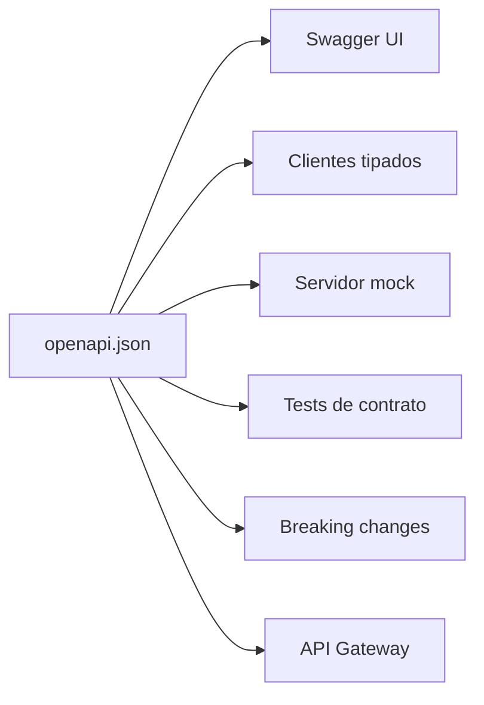

# Documentar la API con OpenAPI 3.1 y Swagger UI (TypeScript + Express + Zod)


## 1. Por qué un contrato escrito

La documentación en un `README` o en un Google Doc tiene un problema estructural: **nada la obliga a ser verdad**. Se escribe una vez, el código cambia, y queda mintiendo.

OpenAPI es distinto porque es **legible por máquinas**. Un documento OpenAPI no es documentación: es un artefacto ejecutable del que se derivan cosas.



Con más detalle: **clientes tipados** en TypeScript, Java o Python; un **servidor
mock** para que el front arranque antes que el back; **detección de breaking
changes** en CI; y la **configuración del API Gateway** si hay uno adelante.

Concretamente, en un equipo de cursada esto significa:

* El grupo que hace el front **empieza antes** de que el back esté listo, contra un mock generado del documento.
* Nadie pregunta "¿qué devuelve este endpoint?": lo abre en Swagger UI y lo prueba.
* Si el back cambia una respuesta sin avisar, **un test lo detecta**.

> **OpenAPI vs Swagger.** "Swagger" era el nombre original de la especificación hasta la versión 2.0. Desde la 3.0 la especificación se llama **OpenAPI** y *Swagger* quedó como el nombre de las herramientas (Swagger UI, Swagger Editor). Usamos **OpenAPI 3.1**, que es la versión actual y la primera que es 100% compatible con JSON Schema — cosa que importa mucho en la sección 6.


## 2. Anatomía de un documento OpenAPI

Un documento OpenAPI es un YAML o JSON con cinco secciones de nivel superior que importan:

```yaml
openapi: 3.1.0          # versión de la ESPECIFICACIÓN

info:                   # metadatos de la API
  title: API de Libros
  version: 1.0.0        # versión de TU API (semver)
  description: API de ejemplo de Programación IV.

servers:                # dónde vive
  - url: http://localhost:3000
    description: Desarrollo
  - url: https://api.ejemplo.edu.ar
    description: Producción

paths:                  # los endpoints
  /v1/books:
    get: { ... }
    post: { ... }

components:             # piezas reutilizables
  schemas: { ... }
  parameters: { ... }
  responses: { ... }
  securitySchemes: { ... }
```

> **Dos versiones distintas.** `openapi: 3.1.0` es la versión del formato del documento. `info.version: 1.0.0` es la versión de tu API. Son independientes y confundirlas es un clásico.

### 2.1 La unidad mínima: una operación

Cada combinación de **path + método** es una *operación*:

```yaml
paths:
  /v1/books/{id}:
    get:
      operationId: getBookById      # ← identificador único; genera el nombre de función
      summary: Obtiene un libro por id
      tags: [Books]
      parameters:
        - name: id
          in: path
          required: true            # en path, SIEMPRE required
          schema: { type: string, format: uuid }
      responses:
        '200':
          description: El libro solicitado
          content:
            application/json:
              schema:
                $ref: '#/components/schemas/BookEnvelope'
        '404':
          $ref: '#/components/responses/NotFound'
```

* **`operationId`** debe ser único en todo el documento. Los generadores de clientes lo usan como nombre de método: `api.getBookById('7')`.
* **`tags`** agrupa operaciones en Swagger UI. Un tag por recurso.
* Los **`parameters`** pueden ir `in: path`, `in: query`, `in: header` o `in: cookie`.


## 3. Describir la API de libros

Arrancamos escribiendo el documento a mano para entender la estructura. En la sección 6 lo generamos desde el código.

```yaml
# openapi.yaml
openapi: 3.1.0
info:
  title: API de Libros
  version: 1.0.0

servers:
  - url: http://localhost:3000

tags:
  - name: Books
    description: Gestión del catálogo de libros

paths:
  /v1/books:
    get:
      operationId: listBooks
      summary: Lista libros con paginación, orden y filtros
      tags: [Books]
      parameters:
        - { name: page,     in: query, schema: { type: integer, minimum: 1, default: 1 } }
        - { name: pageSize, in: query, schema: { type: integer, minimum: 1, maximum: 100, default: 20 } }
        - name: sort
          in: query
          schema:
            type: string
            enum: [title, year, author, -title, -year, -author]
            default: title
        - { name: author,   in: query, schema: { type: string } }
        - { name: yearFrom, in: query, schema: { type: integer } }
        - { name: yearTo,   in: query, schema: { type: integer } }
        - { name: q,        in: query, description: Búsqueda libre, schema: { type: string } }
      responses:
        '200':
          description: Página de resultados
          content:
            application/json:
              schema: { $ref: '#/components/schemas/BookPage' }
        '400':
          $ref: '#/components/responses/ValidationError'

    post:
      operationId: createBook
      summary: Crea un libro
      tags: [Books]
      requestBody:
        required: true
        content:
          application/json:
            schema: { $ref: '#/components/schemas/NewBook' }
      responses:
        '201':
          description: Libro creado
          headers:
            Location:
              description: URL del recurso creado
              schema: { type: string }
          content:
            application/json:
              schema: { $ref: '#/components/schemas/BookEnvelope' }
        '400': { $ref: '#/components/responses/ValidationError' }
        '422': { $ref: '#/components/responses/BusinessRule' }

  /v1/books/{id}:
    parameters:
      - name: id
        in: path
        required: true
        schema: { type: string, format: uuid }
    get:
      operationId: getBookById
      summary: Obtiene un libro
      tags: [Books]
      responses:
        '200':
          description: El libro
          content:
            application/json:
              schema: { $ref: '#/components/schemas/BookEnvelope' }
        '404': { $ref: '#/components/responses/NotFound' }
    patch:
      operationId: updateBook
      summary: Modifica parcialmente un libro
      tags: [Books]
      requestBody:
        required: true
        content:
          application/json:
            schema: { $ref: '#/components/schemas/BookPatch' }
      responses:
        '200':
          description: Libro actualizado
          content:
            application/json:
              schema: { $ref: '#/components/schemas/BookEnvelope' }
        '404': { $ref: '#/components/responses/NotFound' }
        '422': { $ref: '#/components/responses/BusinessRule' }
    delete:
      operationId: deleteBook
      summary: Elimina un libro
      tags: [Books]
      responses:
        '204': { description: Eliminado }
        '404': { $ref: '#/components/responses/NotFound' }
```

Observá que `parameters` está declarado **a nivel del path**, no de cada operación: `{id}` aplica a `get`, `patch` y `delete` por igual. Repetirlo tres veces es el error que convierte un documento en algo imposible de mantener.


## 4. Componentes: no repetirse

`components` es donde vive todo lo reutilizable. La regla práctica: **si algo aparece dos veces, va a components**.

```yaml
components:
  schemas:
    Book:
      type: object
      required: [id, title, author, year]
      properties:
        id:     { type: string, format: uuid, readOnly: true }
        title:  { type: string, minLength: 1, examples: ['Rayuela'] }
        author: { type: string, minLength: 1, examples: ['Julio Cortázar'] }
        year:   { type: integer, maximum: 2026, examples: [1963] }

    NewBook:
      type: object
      required: [title, author, year]
      properties:
        title:  { type: string, minLength: 1 }
        author: { type: string, minLength: 1 }
        year:   { type: integer }

    BookPatch:
      type: object
      minProperties: 1          # un PATCH vacío no tiene sentido
      properties:
        title:  { type: string, minLength: 1 }
        author: { type: string, minLength: 1 }
        year:   { type: integer }

    BookEnvelope:
      type: object
      required: [data]
      properties:
        data: { $ref: '#/components/schemas/Book' }

    PageMeta:
      type: object
      required: [page, pageSize, total, totalPages]
      properties:
        page:       { type: integer }
        pageSize:   { type: integer }
        total:      { type: integer }
        totalPages: { type: integer }

    PageLinks:
      type: object
      properties:
        self:  { type: string }
        first: { type: string }
        prev:  { type: [string, 'null'] }   # 3.1: tipo nullable como unión
        next:  { type: [string, 'null'] }
        last:  { type: string }

    BookPage:
      type: object
      required: [data, meta]
      properties:
        data:  { type: array, items: { $ref: '#/components/schemas/Book' } }
        meta:  { $ref: '#/components/schemas/PageMeta' }
        links: { $ref: '#/components/schemas/PageLinks' }

    Problem:
      type: object
      description: Error según RFC 9457
      required: [type, title, status]
      properties:
        type:     { type: string, format: uri }
        title:    { type: string }
        status:   { type: integer }
        detail:   { type: string }
        instance: { type: string }
        errors:
          type: object
          additionalProperties:
            type: array
            items: { type: string }

  responses:
    ValidationError:
      description: La solicitud no pasó la validación
      content:
        application/problem+json:
          schema: { $ref: '#/components/schemas/Problem' }
    BusinessRule:
      description: Regla de negocio violada
      content:
        application/problem+json:
          schema: { $ref: '#/components/schemas/Problem' }
    NotFound:
      description: Recurso no encontrado
      content:
        application/problem+json:
          schema: { $ref: '#/components/schemas/Problem' }
```

Tres detalles que son específicos de **3.1** y que no funcionaban en 3.0:

| Concepto | 3.0 | 3.1 |
|---|---|---|
| Nullable | `nullable: true` | `type: [string, 'null']` |
| Ejemplos en un schema | `example: 'x'` (uno) | `examples: ['x', 'y']` (array) |
| Compatibilidad | *dialecto* propio de JSON Schema | **JSON Schema Draft 2020-12** completo |

Esa última fila es la razón por la que todo el resto de este apunte es posible: en 3.1, un schema de OpenAPI **es** un JSON Schema, así que cualquier validador de JSON Schema lo entiende directo.

### 4.1 `readOnly` y `writeOnly`

```yaml
id:       { type: string, readOnly: true }   # aparece en respuestas, no se envía
password: { type: string, writeOnly: true }  # se envía, nunca vuelve
```

Esto permite describir `Book` **una sola vez** en lugar de mantener `Book` y `NewBook` en paralelo: el `id` es `readOnly`, así que los generadores lo excluyen del request. Es una decisión de estilo; mantener tipos separados es más explícito y más fácil de leer para quien recién empieza, y es lo que hacemos acá.


## 5. Servir Swagger UI desde Express

```bash
npm i swagger-ui-express yaml
npm i -D @types/swagger-ui-express
```

```ts
// src/docs/openapi.ts
import fs from 'node:fs';
import path from 'node:path';
import YAML from 'yaml';

export function loadOpenApiDocument() {
  const file = path.resolve(process.cwd(), 'openapi.yaml');
  return YAML.parse(fs.readFileSync(file, 'utf8'));
}
```

```ts
// src/app.ts
import swaggerUi from 'swagger-ui-express';
import { loadOpenApiDocument } from './docs/openapi.js';

export function makeApp() {
  const app = express();
  app.use(express.json());

  const service = new BookService();
  app.use('/v1/books', makeBooksRouter(service));
  app.get('/health', (_req, res) => res.json({ ok: true }));

  // Documentación: sólo fuera de producción, o detrás de autenticación.
  if (process.env.NODE_ENV !== 'production') {
    const doc = loadOpenApiDocument();
    app.get('/openapi.json', (_req, res) => res.json(doc));
    app.use('/docs', swaggerUi.serve, swaggerUi.setup(doc, {
      customSiteTitle: 'API de Libros'
    }));
  }

  app.use(errorHandler);
  return app;
}
```

`npm run dev` y la documentación navegable y **ejecutable** queda en `http://localhost:3000/docs`.

> **Decisión de seguridad.** Exponer el documento en producción le entrega a cualquiera el mapa completo de la API: todos los endpoints, todos los campos, todos los formatos. No es una vulnerabilidad por sí misma — una API bien hecha no depende de que sus URLs sean secretas — pero sí le ahorra trabajo de reconocimiento a un atacante. Si la API es pública, publicalo; si es interna, dejalo detrás de la misma autenticación que el resto. Volvemos sobre esto en la Unidad 7.


## 6. Una sola fuente de verdad: generar OpenAPI desde Zod

Hasta acá tenemos **dos** descripciones del mismo contrato:

```ts
// src/routes/books.query.ts  → valida en runtime
export const newBookSchema = z.object({
  title: z.string().min(1),
  author: z.string().min(1),
  year: z.number().int().max(new Date().getFullYear())
});
```

```yaml
# openapi.yaml → documenta
NewBook:
  required: [title, author, year]
  properties: { ... }
```

Dos descripciones del mismo hecho se desincronizan. No es una posibilidad: es cuestión de tiempo. Alguien agrega `isbn` al schema de Zod, el endpoint lo acepta, y la documentación sigue diciendo que no existe.

La solución es **derivar** el documento de los schemas que ya validan.

### 6.1 Con `@asteasolutions/zod-to-openapi`

```bash
npm i @asteasolutions/zod-to-openapi
```

```ts
// src/schemas/book.schema.ts
import { z } from 'zod';
import { extendZodWithOpenApi } from '@asteasolutions/zod-to-openapi';

extendZodWithOpenApi(z);   // agrega el método .openapi() a Zod

export const BookSchema = z.object({
  id:     z.string().uuid().openapi({ example: '3f1a...' }),
  title:  z.string().min(1).openapi({ example: 'Rayuela' }),
  author: z.string().min(1).openapi({ example: 'Julio Cortázar' }),
  year:   z.number().int().openapi({ example: 1963 })
}).openapi('Book');          // ← el nombre en components/schemas

export const NewBookSchema = BookSchema.omit({ id: true }).openapi('NewBook');
export const BookPatchSchema = NewBookSchema.partial().openapi('BookPatch');

export const ProblemSchema = z.object({
  type:     z.string(),
  title:    z.string(),
  status:   z.number().int(),
  detail:   z.string().optional(),
  instance: z.string().optional(),
  errors:   z.record(z.array(z.string())).optional()
}).openapi('Problem');
```

Fijate que `NewBookSchema` y `BookPatchSchema` **se derivan** de `BookSchema` con `.omit()` y `.partial()`. Es imposible que queden desalineados: no son copias, son transformaciones.

```ts
// src/docs/registry.ts
import {
  OpenAPIRegistry, OpenApiGeneratorV31
} from '@asteasolutions/zod-to-openapi';
import {
  BookSchema, NewBookSchema, BookPatchSchema, ProblemSchema
} from '../schemas/book.schema.js';
import { listBooksQuery } from '../routes/books.query.js';
import { z } from 'zod';

export const registry = new OpenAPIRegistry();

const BookPage = z.object({
  data: z.array(BookSchema),
  meta: z.object({
    page: z.number(), pageSize: z.number(),
    total: z.number(), totalPages: z.number()
  }),
  links: z.object({
    self: z.string(), first: z.string(),
    prev: z.string().nullable(), next: z.string().nullable(),
    last: z.string()
  })
}).openapi('BookPage');

const problemResponse = (description: string) => ({
  description,
  content: { 'application/problem+json': { schema: ProblemSchema } }
});

registry.registerPath({
  method: 'get',
  path: '/v1/books',
  operationId: 'listBooks',
  summary: 'Lista libros con paginación, orden y filtros',
  tags: ['Books'],
  request: { query: listBooksQuery },        // ← el MISMO schema que valida
  responses: {
    200: { description: 'Página de resultados',
           content: { 'application/json': { schema: BookPage } } },
    400: problemResponse('La solicitud no pasó la validación')
  }
});

registry.registerPath({
  method: 'post',
  path: '/v1/books',
  operationId: 'createBook',
  summary: 'Crea un libro',
  tags: ['Books'],
  request: {
    body: { required: true,
            content: { 'application/json': { schema: NewBookSchema } } }
  },
  responses: {
    201: { description: 'Libro creado',
           content: { 'application/json': { schema: z.object({ data: BookSchema }) } } },
    400: problemResponse('La solicitud no pasó la validación'),
    422: problemResponse('Regla de negocio violada')
  }
});

// ... getBookById, updateBook, deleteBook

export function buildDocument() {
  return new OpenApiGeneratorV31(registry.definitions).generateDocument({
    openapi: '3.1.0',
    info: { title: 'API de Libros', version: '1.0.0' },
    servers: [{ url: 'http://localhost:3000' }]
  });
}
```

Ahora `openapi.yaml` deja de escribirse a mano. Se genera:

```ts
// scripts/generate-openapi.ts
import fs from 'node:fs';
import YAML from 'yaml';
import { buildDocument } from '../src/docs/registry.js';

fs.writeFileSync('openapi.yaml', YAML.stringify(buildDocument()));
console.log('openapi.yaml generado');
```

```json
{
  "scripts": {
    "openapi": "tsx scripts/generate-openapi.ts",
    "openapi:check": "tsx scripts/generate-openapi.ts && git diff --exit-code openapi.yaml"
  }
}
```

> **`openapi:check` en CI.** Si alguien cambia un schema de Zod y no regenera el documento, `git diff --exit-code` falla y el pipeline se pone en rojo. Es la pieza que convierte "deberíamos mantener la doc actualizada" en algo que el proyecto **garantiza**.

### 6.2 Alternativa: `z.toJSONSchema()` de Zod 4

Zod 4 incorporó conversión a JSON Schema sin dependencias extra:

```ts
const jsonSchema = z.toJSONSchema(BookSchema, { target: 'draft-2020-12' });
```

Alcanza para generar `components/schemas`, pero **no** registra paths ni operaciones: eso hay que armarlo igual. Sirve bien si ya tenés el esqueleto del documento y sólo querés que los schemas se deriven del código.

### 6.3 El otro sentido: generar el cliente

Con el documento como fuente de verdad, el front deja de escribir `fetch` a mano:

```bash
npx openapi-typescript openapi.yaml -o src/api/types.ts
```

Eso produce tipos de TypeScript para cada request y cada response. Combinado con `openapi-fetch`, el front consume la API con autocompletado y errores de compilación si el contrato cambió:

```ts
import createClient from 'openapi-fetch';
import type { paths } from './api/types';

const api = createClient<paths>({ baseUrl: 'http://localhost:3000' });

const { data, error } = await api.GET('/v1/books', {
  params: { query: { page: 1, sort: '-year' } }
});
// data está tipado como BookPage; 'sort: "pasword"' no compila.
```

Lo retomamos en la Unidad 5, cuando el front consuma esta API.


## 7. Tests de contrato

Un test de contrato no verifica *qué* devuelve el endpoint, sino que **lo que devuelve cumple el documento**. Es la red que detecta la desincronización.

```bash
npm i -D ajv ajv-formats
```

```ts
// tests/helpers/contract.ts
import Ajv from 'ajv/dist/2020.js';       // ← Draft 2020-12, el de OpenAPI 3.1
import addFormats from 'ajv-formats';
import { buildDocument } from '../../src/docs/registry.js';

const doc = buildDocument();
const ajv = new Ajv({ strict: false, allErrors: true });
addFormats(ajv);

// Registramos components/schemas para que los $ref resuelvan
for (const [name, schema] of Object.entries(doc.components?.schemas ?? {})) {
  ajv.addSchema(schema as object, `#/components/schemas/${name}`);
}

export function expectMatchesSchema(body: unknown, schemaName: string) {
  const schema = doc.components?.schemas?.[schemaName];
  if (!schema) throw new Error(`Schema ${schemaName} no está en el documento`);

  const validate = ajv.compile(schema as object);
  if (!validate(body)) {
    throw new Error(
      `La respuesta no cumple ${schemaName}:\n` +
      JSON.stringify(validate.errors, null, 2)
    );
  }
}
```

```ts
// tests/contract/books.contract.test.ts
import request from 'supertest';
import { makeApp } from '../../src/app.js';
import { expectMatchesSchema } from '../helpers/contract.js';

describe('contrato OpenAPI', () => {
  it('GET /v1/books cumple BookPage', async () => {
    const res = await request(makeApp()).get('/v1/books');

    expect(res.status).toBe(200);
    expectMatchesSchema(res.body, 'BookPage');
  });

  it('POST /v1/books devuelve un Book válido', async () => {
    const res = await request(makeApp())
      .post('/v1/books')
      .send({ title: 'Rayuela', author: 'Cortázar', year: 1963 });

    expect(res.status).toBe(201);
    expectMatchesSchema(res.body.data, 'Book');
  });

  it('los errores cumplen Problem', async () => {
    const res = await request(makeApp()).get('/v1/books/inexistente');

    expect(res.status).toBe(404);
    expectMatchesSchema(res.body, 'Problem');
  });
});
```

### 7.1 El test que realmente encuentra bugs

Los tres de arriba verifican que la respuesta **tenga** lo que promete. Falta el inverso: que no tenga **de más**. Ese es el que atrapa la filtración de campos internos.

```ts
it('no filtra campos no declarados en el contrato', async () => {
  const res = await request(makeApp())
    .post('/v1/books')
    .send({ title: 'X', author: 'Y', year: 2020 });

  const declarados = ['id', 'title', 'author', 'year'];
  expect(Object.keys(res.body.data).sort()).toEqual(declarados.sort());
});
```

El día que alguien agregue un campo `internalNotes` o `_rawRow` al objeto que se serializa, este test falla. En la Unidad 4, cuando `Book` venga de una base de datos, va a ser el test más valioso del archivo.

> **Alternativa conocida:** `jest-openapi` agrega el matcher `expect(res).toSatisfyApiSpec()`, que hace el mismo trabajo con menos código pero resuelve la operación por path y método. Si el proyecto usa Jest, es una opción válida; el helper con Ajv funciona igual en Jest y en Vitest y deja a la vista el mecanismo.


## 8. Evolución del documento

### 8.1 Versionar el documento con la API

`info.version` sigue semver y acompaña a la versión de la URL:

| Cambio | `info.version` | Prefijo de URL |
|---|---|---|
| Agregar un endpoint | `1.0.0` → `1.1.0` | `/v1` |
| Agregar un campo opcional | `1.0.0` → `1.1.0` | `/v1` |
| Corregir la descripción de un campo | `1.0.0` → `1.0.1` | `/v1` |
| Quitar o renombrar un campo | `1.x` → `2.0.0` | `/v2` |

### 8.2 Detectar breaking changes automáticamente

Teniendo el documento en el repo, un cambio incompatible se puede detectar **antes** de mergear:

```bash
# compara el documento de la rama contra el de main
npx @useoptic/openapi-diff ... # o:
docker run --rm -v "$PWD:/w" tufin/oasdiff breaking /w/base.yaml /w/openapi.yaml
```

En CI, el paso falla si aparece un cambio incompatible sin un bump de major. Lo integramos al pipeline en la Unidad 9.

### 8.3 Mantener el documento legible

A medida que la API crece, un `openapi.yaml` de 3.000 líneas es ilegible. Dos reglas:

* **Todo lo repetido va a `components`.** Si escribiste dos veces la misma respuesta de error, está mal.
* **Un tag por recurso**, con `description`. Swagger UI agrupa por tag y es la única navegación que tiene quien lo lee por primera vez.

