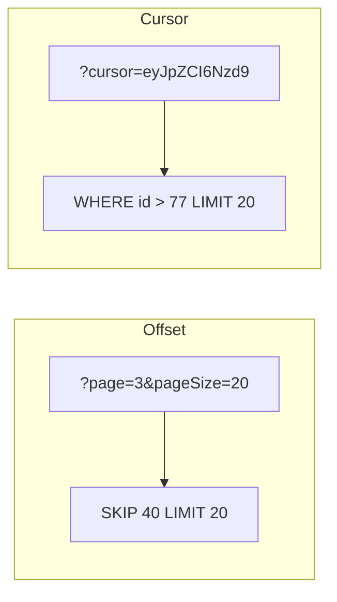
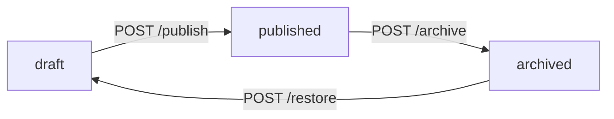

# Diseño de APIs REST: recursos, contrato y colecciones (TypeScript + Express + Zod)

## 1. De "endpoints que funcionan" a un contrato

El código de la unidad anterior funciona:

```ts
// src/routes/books.ts (estado actual)
router.post('/', (req, res) => { /* crea un libro */ });
router.get('/',  (req, res) => { /* lista libros  */ });
```

Funciona, pero no es todavía una **API**: es un conjunto de funciones accesibles por HTTP. La diferencia está en el **contrato**: la promesa estable que le hacemos a quien consume.

| Sin contrato | Con contrato |
|---|---|
| "Devuelve un array" | `200` con `{ data, meta }`, `data` es un array de `Book` |
| "Si falla tira 500" | `400` validación, `404` inexistente, `409` conflicto, `422` regla de negocio |
| "Agregamos un campo y listo" | Agregar es compatible; renombrar o quitar es *breaking* y requiere versión |
| El front descubre la forma probando | El front lee el contrato y programa contra él |

Un contrato se sostiene sobre cuatro decisiones, y son las cuatro que toma este apunte:


> **Regla de oro de la unidad:** el contrato es lo primero que se diseña y lo último que se cambia.


## 2. Recursos, no acciones

REST modela **sustantivos** (recursos), no **verbos** (operaciones). El verbo ya lo pone HTTP.

### 2.1 El error más común

```text
POST /crearLibro
POST /borrarLibro?id=7
GET  /obtenerLibrosDelAutor?autor=Borges
POST /actualizarAñoDelLibro
```

Son cuatro URLs distintas para un mismo recurso, el método HTTP no significa nada y nada de esto es cacheable ni predecible. La versión por recursos:

```text
POST   /books
DELETE /books/7
GET    /books?author=Borges
PATCH  /books/7
```

Cuatro operaciones, **una sola URL de colección** y **una de ítem**.

### 2.2 Las dos formas de URL

Toda API REST se arma repitiendo dos patrones:

| Patrón | Ejemplo | Identifica |
|---|---|---|
| Colección | `/books` | el conjunto de libros |
| Ítem | `/books/{id}` | un libro concreto |

Y se anidan cuando hay una relación de pertenencia real:

```text
/books/{id}/reviews        → las reseñas de un libro
/books/{id}/reviews/{rid}  → una reseña concreta
```

### 2.3 Cuándo NO anidar

Anidar más de dos niveles es casi siempre un error de diseño:

```text
❌ /authors/3/books/7/reviews/12/comments/4
✅ /comments/4
✅ /comments?reviewId=12
```

El criterio: **anidá sólo si el hijo no tiene sentido fuera del padre**. Una reseña sin libro no significa nada → se anida. Un comentario ya tiene su propio id global → se expone como recurso de primer nivel y se filtra por query.

### 2.4 Convenciones que conviene fijar de entrada

* **Plural** para colecciones: `/books`, no `/book`.
* **kebab-case** si la URL tiene más de una palabra: `/reading-lists`.
* **Sin extensión ni verbo**: nada de `/books.json` ni `/getBooks`.
* **Sin barra final**: `/books`, no `/books/`.
* **Los ids son opacos**: quien consume no debe asumir que son numéricos ni correlativos.

### 2.5 La excepción honesta: acciones que no son recursos

A veces hay una operación que realmente no es un CRUD sobre un recurso: reenviar un mail, recalcular un índice, publicar un borrador. Forzarla a ser un recurso produce diseños peores que admitir la excepción.

```text
POST /books/7/publish      ← acción explícita, aceptada por convención
POST /books/7/restore
```

Es legítimo **si es la excepción**. Si la mitad de tu API son acciones, el modelo de recursos está mal planteado.


## 3. Métodos HTTP: seguridad e idempotencia

Las dos propiedades que definen la semántica de cada método:

* **Seguro (safe):** no modifica estado del servidor. Se puede ejecutar mil veces sin consecuencias.
* **Idempotente:** ejecutarlo N veces deja el mismo estado final que ejecutarlo una vez.

| Método | Seguro | Idempotente | Uso en `/books` |
|---|:--:|:--:|---|
| `GET` | ✅ | ✅ | leer colección o ítem |
| `HEAD` | ✅ | ✅ | metadatos sin cuerpo |
| `POST` | ❌ | ❌ | crear (el servidor asigna el id) |
| `PUT` | ❌ | ✅ | reemplazo completo del ítem |
| `PATCH` | ❌ | ❌* | modificación parcial |
| `DELETE` | ❌ | ✅ | eliminar |

> `PATCH` es idempotente *si* el parche es absoluto (`{ "year": 1994 }`). No lo es si es relativo (`{ "incrementStock": 1 }`).

**Por qué importa de verdad:** esto no es teoría de examen. Los proxies, las CDN y los navegadores **reintentan automáticamente** métodos idempotentes ante un timeout. Si implementás una creación con `PUT` sin id provisto por el cliente, un reintento te crea dos libros. Si implementás una lectura con `POST`, perdés toda la caché (lo vemos en la Unidad 1).

### 3.1 `PUT` vs `PATCH` en la práctica

```ts
// PUT /books/7 → el body es el libro COMPLETO. Lo que falta, se borra.
{ "title": "Rayuela", "author": "Cortázar", "year": 1963 }

// PATCH /books/7 → el body son SÓLO los campos a cambiar.
{ "year": 1963 }
```

El error clásico es implementar `PUT` como si fuera `PATCH` (mergear en lugar de reemplazar). Queda una API donde es **imposible borrar un campo opcional**.

En la práctica, para la mayoría de las APIs: **exponé `PATCH` y no expongas `PUT`**. Es menos frágil frente a clientes desactualizados y evita el merge accidental.


## 4. Estados y errores: el formato uniforme

### 4.1 Qué código devolver

| Código | Cuándo | En nuestra API de libros |
|---|---|---|
| `200 OK` | éxito con cuerpo | `GET /books`, `PATCH /books/7` |
| `201 Created` | se creó un recurso | `POST /books` + header `Location` |
| `204 No Content` | éxito sin cuerpo | `DELETE /books/7` |
| `400 Bad Request` | el request está mal formado | JSON inválido, query mal tipada |
| `401 Unauthorized` | falta identidad | (Unidad 3) |
| `403 Forbidden` | hay identidad pero no permiso | (Unidad 3) |
| `404 Not Found` | el recurso no existe | `GET /books/999` |
| `409 Conflict` | choque con el estado actual | ISBN duplicado |
| `422 Unprocessable Content` | sintaxis válida, **regla de negocio** violada | `year` futuro |
| `429 Too Many Requests` | rate limiting | (Unidad 7) |
| `500 Internal Server Error` | error nuestro, no del cliente | bug |

> **`400` vs `422`:** `400` es "no entiendo lo que me mandaste"; `422` es "te entiendo perfectamente, pero no puedo aceptarlo". `{ "year": "mil" }` es `400`. `{ "year": 2097 }` es `422`. La distinción le sirve al front: ante `400` hay un bug del cliente; ante `422` hay que mostrarle el mensaje al usuario.

### 4.2 Un solo formato de error para toda la API

Nada hace más difícil consumir una API que tres formatos de error distintos. Usamos **RFC 9457 (`application/problem+json`)**, que es el estándar actual:

```ts
// src/http/problem.ts
export type Problem = {
  type: string;      // URI que identifica el tipo de error
  title: string;     // resumen legible, estable
  status: number;    // el mismo status HTTP
  detail?: string;   // explicación de ESTA ocurrencia
  instance?: string; // la URL que falló
  errors?: Record<string, string[]>; // detalle por campo (validación)
};

export function problem(
  res: import('express').Response,
  p: Omit<Problem, 'instance'> & { instance?: string }
) {
  return res
    .status(p.status)
    .type('application/problem+json')
    .json(p);
}
```

Un error de validación queda así:

```json
{
  "type": "https://api.utn.edu.ar/errors/validation",
  "title": "La solicitud no pasó la validación",
  "status": 400,
  "detail": "Revisá los campos indicados en 'errors'.",
  "instance": "/v1/books",
  "errors": {
    "year": ["Expected number, received string"],
    "title": ["String must contain at least 1 character(s)"]
  }
}
```

### 4.3 Middleware centralizado de errores

El objetivo es que **ninguna ruta** arme un error a mano. Las rutas lanzan, el middleware traduce.

```ts
// src/http/errors.ts
export class AppError extends Error {
  constructor(
    public status: number,
    public type: string,
    public title: string,
    public detail?: string,
    public errors?: Record<string, string[]>
  ) { super(title); }
}

export const notFound = (what: string, id: string) =>
  new AppError(404, 'https://api.utn.edu.ar/errors/not-found',
    `${what} no encontrado`, `No existe ${what} con id ${id}.`);

export const businessRule = (detail: string) =>
  new AppError(422, 'https://api.utn.edu.ar/errors/business-rule',
    'Regla de negocio violada', detail);

export const conflict = (detail: string) =>
  new AppError(409, 'https://api.utn.edu.ar/errors/conflict',
    'Conflicto con el estado actual', detail);
```

```ts
// src/http/errorHandler.ts
import type { ErrorRequestHandler } from 'express';
import { ZodError } from 'zod';
import { AppError } from './errors.js';

export const errorHandler: ErrorRequestHandler = (err, req, res, _next) => {
  if (err instanceof ZodError) {
    return res.status(400).type('application/problem+json').json({
      type: 'https://api.utn.edu.ar/errors/validation',
      title: 'La solicitud no pasó la validación',
      status: 400,
      instance: req.originalUrl,
      errors: err.flatten().fieldErrors
    });
  }

  if (err instanceof AppError) {
    return res.status(err.status).type('application/problem+json').json({
      type: err.type,
      title: err.title,
      status: err.status,
      detail: err.detail,
      instance: req.originalUrl,
      errors: err.errors
    });
  }

  // Error no previsto: NUNCA filtrar el stack al cliente.
  console.error(err);
  return res.status(500).type('application/problem+json').json({
    type: 'about:blank',
    title: 'Error interno',
    status: 500,
    instance: req.originalUrl
  });
};
```

Se registra **al final** de `makeApp()`, después de todas las rutas:

```ts
// src/app.ts
export function makeApp() {
  const app = express();
  app.use(express.json());

  const service = new BookService();
  app.use('/v1/books', makeBooksRouter(service));
  app.get('/health', (_req, res) => res.json({ ok: true }));

  app.use(errorHandler); // ← siempre último
  return app;
}
```

> **Cuidado con async:** en Express 4, un `throw` dentro de un handler `async` **no** llega al middleware de errores; hay que capturar y llamar `next(err)` (o usar un wrapper `asyncHandler`). En Express 5 ya se propaga solo.

### 4.4 Test del contrato de error

Es exactamente el mismo ciclo de TDD del apunte anterior, ahora aplicado al contrato:

```ts
// tests/integration/books.errors.test.ts
import request from 'supertest';
import { makeApp } from '../../src/app.js';

describe('contrato de errores', () => {
  it('404 con problem+json cuando el libro no existe', async () => {
    const res = await request(makeApp()).get('/v1/books/no-existe');

    expect(res.status).toBe(404);
    expect(res.headers['content-type']).toMatch(/application\/problem\+json/);
    expect(res.body).toMatchObject({ status: 404, title: expect.any(String) });
  });

  it('422 cuando el year es futuro (regla de negocio, no sintaxis)', async () => {
    const res = await request(makeApp())
      .post('/v1/books')
      .send({ title: 'X', author: 'Y', year: new Date().getFullYear() + 5 });

    expect(res.status).toBe(422);
  });

  it('400 cuando el year no es un número (sintaxis)', async () => {
    const res = await request(makeApp())
      .post('/v1/books')
      .send({ title: 'X', author: 'Y', year: 'mil novecientos' });

    expect(res.status).toBe(400);
    expect(res.body.errors).toHaveProperty('year');
  });
});
```


## 5. Colecciones: paginación, orden y filtros

`GET /books` devolviendo un array de 40.000 elementos es una bomba de tiempo: funciona en la demo y tira el servidor en producción. **Toda colección se pagina desde el día uno**, aunque hoy tenga tres registros.

### 5.1 Las dos estrategias



| | Offset / página | Cursor / keyset |
|---|---|---|
| URL | `?page=3&pageSize=20` | `?cursor=abc&limit=20` |
| Saltar a página N | ✅ directo | ❌ sólo siguiente/anterior |
| Costo en la base | crece con el offset | constante |
| Datos que cambian mientras paginás | ❌ repite o saltea ítems | ✅ estable |
| Cuándo usarla | back-office, tablas con paginador | feeds, scroll infinito, volumen alto |

Para la API de libros usamos **offset**, que es lo que espera una tabla con paginador. En la Unidad 4, cuando aparezca la base de datos real, vamos a ver por qué el offset se degrada.

### 5.2 Validar los parámetros de query con Zod

Los query params **siempre** llegan como string. Convertirlos a mano en cada ruta es la fuente número uno de bugs de paginación:

```ts
// src/routes/books.query.ts
import { z } from 'zod';

export const listBooksQuery = z.object({
  page:     z.coerce.number().int().positive().default(1),
  pageSize: z.coerce.number().int().positive().max(100).default(20),
  // whitelist explícita: NUNCA pasar un campo de orden crudo al repositorio
  sort:     z.enum(['title', 'year', 'author', '-title', '-year', '-author'])
              .default('title'),
  author:   z.string().min(1).optional(),
  yearFrom: z.coerce.number().int().optional(),
  yearTo:   z.coerce.number().int().optional(),
  q:        z.string().min(1).optional()   // búsqueda libre
}).refine(
  v => v.yearFrom == null || v.yearTo == null || v.yearFrom <= v.yearTo,
  { message: 'yearFrom no puede ser mayor que yearTo', path: ['yearFrom'] }
);

export type ListBooksQuery = z.infer<typeof listBooksQuery>;
```

Tres decisiones deliberadas en ese schema:

1. **`z.coerce`** hace el casteo de string a número en un solo lugar.
2. **`.max(100)` en `pageSize`** evita que un cliente pida `?pageSize=999999` y tire la API. Un límite sin tope no es un límite.
3. **`z.enum` en `sort`**, no `z.string()`. Cuando en la Unidad 4 esto vaya a una base de datos, un campo de orden libre es una vía de inyección y de *full scan*. La whitelist se define ahora.

### 5.3 La convención de orden

Un solo parámetro, prefijo `-` para descendente, coma para multi-campo:

```text
?sort=title        → título ascendente
?sort=-year        → año descendente
?sort=-year,title  → año descendente, y a igual año, título ascendente
```

```ts
export function parseSort(sort: string) {
  return sort.split(',').map(s => ({
    field: s.startsWith('-') ? s.slice(1) : s,
    dir:   s.startsWith('-') ? 'desc' as const : 'asc' as const
  }));
}
```

### 5.4 El sobre de respuesta

Devolver un array pelado no deja lugar para los metadatos de paginación. Usamos un sobre `{ data, meta }`:

```ts
// src/http/envelope.ts
export type Page<T> = {
  data: T[];
  meta: {
    page: number;
    pageSize: number;
    total: number;
    totalPages: number;
  };
  links: {
    self: string;
    first: string;
    prev: string | null;
    next: string | null;
    last: string;
  };
};

export function buildLinks(baseUrl: string, q: Record<string, unknown>,
                           page: number, totalPages: number) {
  const url = (p: number) => {
    const sp = new URLSearchParams();
    for (const [k, v] of Object.entries({ ...q, page: p })) {
      if (v !== undefined && v !== null) sp.set(k, String(v));
    }
    return `${baseUrl}?${sp.toString()}`;
  };

  return {
    self:  url(page),
    first: url(1),
    prev:  page > 1 ? url(page - 1) : null,
    next:  page < totalPages ? url(page + 1) : null,
    last:  url(Math.max(totalPages, 1))
  };
}
```

> **Coherencia:** si la colección devuelve `{ data, meta }`, el ítem individual también debe devolver `{ data }`. Una API donde `GET /books` devuelve un objeto y `GET /books/7` devuelve otro objeto con forma distinta obliga al front a escribir dos deserializadores.

### 5.5 El servicio y la ruta completos

```ts
// src/services/bookService.ts (extendido)
import type { ListBooksQuery } from '../routes/books.query.js';
import { parseSort } from '../routes/books.query.js';
import { businessRule } from '../http/errors.js';

export type NewBook = { title: string; author: string; year: number };
export type Book = NewBook & { id: string };

export class BookService {
  private data: Book[] = [];

  create(input: NewBook): Book {
    if (input.year > new Date().getFullYear()) {
      throw businessRule('El año no puede ser mayor al año actual.');
    }
    const book: Book = { ...input, id: crypto.randomUUID() };
    this.data.push(book);
    return book;
  }

  search(q: ListBooksQuery): { items: Book[]; total: number } {
    let items = [...this.data];

    if (q.author)   items = items.filter(b => b.author === q.author);
    if (q.yearFrom) items = items.filter(b => b.year >= q.yearFrom!);
    if (q.yearTo)   items = items.filter(b => b.year <= q.yearTo!);
    if (q.q) {
      const needle = q.q.toLowerCase();
      items = items.filter(b =>
        b.title.toLowerCase().includes(needle) ||
        b.author.toLowerCase().includes(needle));
    }

    for (const { field, dir } of parseSort(q.sort).reverse()) {
      items.sort((a, b) => {
        const va = a[field as keyof Book], vb = b[field as keyof Book];
        const cmp = va < vb ? -1 : va > vb ? 1 : 0;
        return dir === 'asc' ? cmp : -cmp;
      });
    }

    const total = items.length;
    const start = (q.page - 1) * q.pageSize;
    return { items: items.slice(start, start + q.pageSize), total };
  }
}
```

> **Nota sobre el `.reverse()`:** `Array.sort` es estable en todos los motores modernos, así que para ordenar por varios campos se aplican los criterios del menos significativo al más significativo. Es el tipo de detalle que un test de ordenamiento multi-campo descubre y una lectura rápida no.

```ts
// src/routes/books.ts (listado)
router.get('/', (req, res) => {
  const q = listBooksQuery.parse(req.query); // ZodError → 400 vía errorHandler
  const { items, total } = service.search(q);
  const totalPages = Math.ceil(total / q.pageSize);

  res.json({
    data: items,
    meta: { page: q.page, pageSize: q.pageSize, total, totalPages },
    links: buildLinks('/v1/books', { ...q, page: undefined }, q.page, totalPages)
  });
});
```

### 5.6 Tests del contrato de colección

```ts
// tests/integration/books.list.test.ts
import request from 'supertest';
import { makeApp } from '../../src/app.js';

const seed = async (app: ReturnType<typeof makeApp>, n: number) => {
  for (let i = 1; i <= n; i++) {
    await request(app).post('/v1/books')
      .send({ title: `Libro ${String(i).padStart(2, '0')}`, author: 'A', year: 2000 + i });
  }
};

describe('GET /v1/books', () => {
  it('pagina con los valores por defecto', async () => {
    const app = makeApp();
    await seed(app, 45);

    const res = await request(app).get('/v1/books');

    expect(res.status).toBe(200);
    expect(res.body.data).toHaveLength(20);
    expect(res.body.meta).toMatchObject({ page: 1, pageSize: 20, total: 45, totalPages: 3 });
    expect(res.body.links.prev).toBeNull();
    expect(res.body.links.next).toContain('page=2');
  });

  it('rechaza un pageSize por encima del tope', async () => {
    const res = await request(makeApp()).get('/v1/books?pageSize=5000');
    expect(res.status).toBe(400);
  });

  it('rechaza un campo de orden fuera de la whitelist', async () => {
    const res = await request(makeApp()).get('/v1/books?sort=password');
    expect(res.status).toBe(400);
  });

  it('ordena descendente por año', async () => {
    const app = makeApp();
    await seed(app, 5);

    const res = await request(app).get('/v1/books?sort=-year');
    const years = res.body.data.map((b: any) => b.year);

    expect(years).toEqual([...years].sort((a, b) => b - a));
  });
});
```

Ese último test es el patrón más útil para ordenamientos: **no hardcodea el resultado esperado**, verifica la propiedad "está ordenado". Sigue pasando cuando cambian los datos de prueba.


## 6. Versionado

Toda API que se usa, cambia. La pregunta no es *si* vas a romper el contrato sino *cómo* lo vas a administrar.

### 6.1 Qué rompe y qué no

| Cambio | ¿Breaking? |
|---|:--:|
| Agregar un campo **opcional** a la respuesta | No |
| Agregar un endpoint nuevo | No |
| Agregar un query param con default | No |
| Relajar una validación (aceptar más) | No |
| **Quitar o renombrar** un campo | **Sí** |
| **Cambiar el tipo** de un campo (`number` → `string`) | **Sí** |
| **Agregar un campo requerido** al request | **Sí** |
| **Cambiar un status code** (`200` → `204`) | **Sí** |
| Endurecer una validación | **Sí** |

> El criterio práctico: **agregar es seguro, quitar y cambiar no lo es.** Y los clientes viejos siguen existiendo aunque hayas avisado.

### 6.2 Dónde poner la versión

| Estrategia | Ejemplo | Comentario |
|---|---|---|
| **En la URL** | `/v1/books` | La que usamos. Visible, cacheable, trivial de rutear y de probar con `curl`. |
| Header | `Accept: application/vnd.utn.v2+json` | Más "purista", pero invisible en logs y molesta de probar. |
| Query param | `/books?version=2` | Ensucia la caché y se mezcla con los filtros. |

Para un curso y para la mayoría de los equipos: **versión en la URL, sólo major**. No existe `/v1.2`; los cambios menores son compatibles por definición.

```ts
app.use('/v1/books', makeBooksRouter(service));
// cuando llegue v2, conviven:
// app.use('/v2/books', makeBooksRouterV2(service));
```

### 6.3 Deprecación ordenada

Sacar `/v1` de un día para el otro es romper producción. El procedimiento es:

1. Publicar `/v2` y documentar el diff.
2. Marcar `/v1` como deprecada con headers estándar (RFC 8594 / RFC 9745):

```ts
const deprecate = (sunset: string, successor: string) =>
  ((_req, res, next) => {
    res.set('Deprecation', 'true');
    res.set('Sunset', sunset);                       // fecha HTTP
    res.set('Link', `<${successor}>; rel="successor-version"`);
    next();
  }) as import('express').RequestHandler;

app.use('/v1', deprecate('Sat, 01 Aug 2026 00:00:00 GMT', '/v2/books'));
```

3. Medir el tráfico que todavía usa `/v1` (Unidad 10: métricas por versión).
4. Apagar `/v1` recién cuando ese número sea cero o aceptable.


## 7. HATEOAS e hipermedia

### 7.1 La idea

**HATEOAS** (*Hypermedia As The Engine Of Application State*) dice que la respuesta no debe traer sólo datos, sino también **qué se puede hacer ahora** con esos datos, en forma de links. El cliente navega la API como se navega un sitio web: siguiendo enlaces, no construyendo URLs.

```json
{
  "data": {
    "id": "7", "title": "Rayuela", "author": "Cortázar",
    "year": 1963, "status": "draft"
  },
  "links": {
    "self":    { "href": "/v1/books/7", "method": "GET" },
    "update":  { "href": "/v1/books/7", "method": "PATCH" },
    "publish": { "href": "/v1/books/7/publish", "method": "POST" },
    "reviews": { "href": "/v1/books/7/reviews", "method": "GET" }
  }
}
```

Lo interesante es lo que **no** aparece: si el libro ya estuviera publicado, el link `publish` no vendría. El servidor comunica la máquina de estados; el front **no tiene que reimplementar la regla** "el botón Publicar se muestra sólo si status === 'draft'".



### 7.2 La discusión honesta

HATEOAS es el nivel 3 del modelo de madurez de Richardson y es la parte de REST que **casi nadie implementa completa**. Las razones:

* Requiere un cliente que descubra links en runtime; los front-ends reales rutean con URLs fijas.
* Infla las respuestas.
* Sin un formato estándar acordado (HAL, JSON:API, Siren), cada API inventa el suyo y se pierde el beneficio.

**Dónde sí vale la pena**, y es lo que adoptamos:

* **Links de paginación** (`next`, `prev`, `first`, `last`) — ya lo hicimos en 4.4. Es HATEOAS aplicado, y resuelve un problema real.
* **Links de acciones condicionadas por estado**, cuando hay una máquina de estados no trivial.

> Posición del curso: adoptamos la **hipermedia útil**, no la ortodoxia. Que el front no tenga que duplicar las reglas de transición del servidor es una ganancia concreta; que descubra toda la API en runtime, no.

### 7.3 Modelo de madurez de Richardson

| Nivel | Qué tiene | Ejemplo |
|---|---|---|
| 0 | HTTP como túnel | un solo `POST /api` con `{"op":"getBooks"}` |
| 1 | Recursos | `/books`, `/books/7` |
| 2 | Verbos + códigos de estado | `GET/POST/PATCH/DELETE` + `200/201/404/422` |
| 3 | Hipermedia | links en las respuestas |

La mayor parte de lo que la industria llama "REST" es **nivel 2**, y es un objetivo perfectamente razonable. Nuestra API de libros queda en nivel 2 con los links de paginación del nivel 3.


## 8. Errores de diseño frecuentes

| Síntoma | Por qué duele | Qué hacer |
|---|---|---|
| `200 OK` con `{ "error": "..." }` adentro | El cliente no puede usar `res.ok`; los reintentos, el cacheo y el monitoreo se rompen | Usar el status correcto |
| Un `GET` que modifica estado | Un *prefetch* del navegador o un crawler ejecuta la acción | Nunca mutar en `GET` |
| Devolver el stack trace en `500` | Filtra rutas, versiones y estructura interna | Loguear adentro, responder genérico |
| Listado sin paginación | Funciona con 10 registros, muere con 100.000 | Paginar desde el día uno |
| `sort` como string libre | Vía de inyección y de *full scan* | Whitelist con `z.enum` |
| Fechas con formato propio (`"12/03/2025"`) | Ambigüedad día/mes y zona horaria | **ISO 8601 UTC** siempre |
| Números con decimales en `float` para plata | `0.1 + 0.2 !== 0.3` | Enteros en centavos, o string decimal |
| Campos en `snake_case` y `camelCase` mezclados | Fricción permanente en el cliente | Elegir uno y documentarlo |
| `null` y campo ausente usados indistintamente | `null` = "sin valor"; ausente = "no se tocó" (clave en `PATCH`) | Definir cuál significa qué |
| Exponer el id de la base de datos como id público | Filtra volumen de negocio y facilita enumerar recursos | UUID u otro id opaco |

