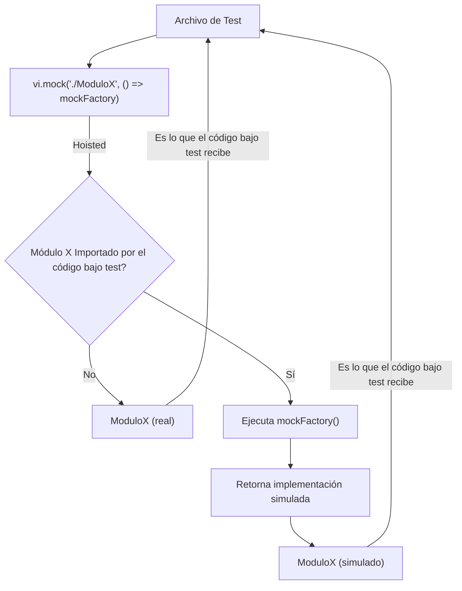

# Guía de Vitest: Empezando y Mockeando

Vitest es un framework de testing rápido y moderno, diseñado para proyectos JavaScript y TypeScript. Se integra perfectamente con Vite, aprovechando su velocidad y simplicidad. Esta guía cubre los fundamentos de Vitest y profundiza en una de sus características más potentes: `vi.mock` para la simulación de módulos.

## **Parte 1: Introducción a Vitest (Basado en Betterstack)**

Vitest fue creado para ser un reemplazo rápido y eficiente para Jest, especialmente en el ecosistema de Vite.

**1. ¿Por qué Vitest?**

*   **Velocidad:** Aprovecha el sistema de HMR (Hot Module Replacement) de Vite para tests increíblemente rápidos, recompilando solo los módulos afectados.
*   **Integración con Vite:** Funciona "out-of-the-box" con tus proyectos Vite, utilizando la misma configuración de `vite.config.ts` (alias, plugins, etc.).
*   **Desarrollo Moderno:** Soporte nativo para ES Modules, TypeScript, JSX/TSX.
*   **Experiencia de Desarrollador (DX):** Ofrece funcionalidades como Watch Mode inteligente, cobertura de código integrada y API inspirada en Jest, lo que facilita la migración.
*   **Simplicidad:** Configuración mínima necesaria para empezar.

**2. Instalación y Configuración Básica**

Para añadir Vitest a tu proyecto Vite:

```bash
npm install -D vitest
# o
yarn add -D vitest
# o
pnpm add -D vitest
```

**`vite.config.ts` (Opcional pero recomendado para configuración global):**

```typescript
// vite.config.ts
import { defineConfig } from 'vite'

export default defineConfig({
  // ... tus configuraciones de Vite ...
  test: {
    globals: true, // Habilita APIs globales como `describe`, `it`, `expect`
    environment: 'jsdom', // Para tests de UI/DOM (React, Vue, etc.)
    setupFiles: './vitest.setup.ts', // Archivo de configuración global para tests
    // ... otras opciones de Vitest ...
  },
})
```

**3. Escribiendo tu Primer Test**

Crea un archivo de test (por ejemplo, `sum.test.ts`):

```typescript
// sum.ts
export function sum(a: number, b: number) {
  return a + b;
}

// sum.test.ts
import { describe, it, expect } from 'vitest'; // No necesario si globals: true
import { sum } from './sum';

describe('sum', () => {
  it('should add two numbers', () => {
    expect(sum(1, 2)).toBe(3);
  });

  it('should handle negative numbers', () => {
    expect(sum(-1, 5)).toBe(4);
  });
});
```

**4. Ejecutando Tests**

Añade un script a tu `package.json`:

```json
{
  "scripts": {
    "test": "vitest",
    "test:ui": "vitest --ui", // Para una interfaz gráfica de tests
    "test:coverage": "vitest run --coverage" // Para generar reportes de cobertura
  }
}
```

Luego ejecuta `npm run test` (o `yarn test`, `pnpm test`).

**5. Características Clave de Vitest:**

*   **API Familiar:** `describe`, `it` (o `test`), `expect` funcionan de manera muy similar a Jest.
*   **Matchers Extensivos:** Amplia gama de matchers para `expect` ( `toBe`, `toEqual`, `toHaveBeenCalledWith`, etc.).
*   **Simulaciones (Mocks):** Funciones `vi.fn()`, `vi.spyOn()` y `vi.mock()` para controlar el comportamiento de funciones y módulos.
*   **Modos de Ejecución:**
    *   **Watch Mode (por defecto):** Ejecuta tests automáticamente al guardar cambios.
    *   **Run Mode (`vitest run`):** Ejecuta todos los tests una vez y sale.
*   **Cobertura de Código:** Integración con librerías como `c8` o `istanbul` para reportes de cobertura.
*   **Entornos (Environments):**
    *   `node` (por defecto): Para tests de lógica de backend.
    *   `jsdom`: Simula un entorno de navegador para tests de componentes de UI.
    *   `happy-dom`: Una alternativa más ligera a JSDOM.


## **Parte 2: Mocks Avanzados con `vi.mock` (Basado en Vitest.dev)**

`vi.mock` es una función fundamental en Vitest para la gestión de **módulos simulados (mocks)**. Permite interceptar las dependencias de tus módulos y reemplazarlas por implementaciones falsas, crucial para aislar el código que estás probando y asegurar que tus tests sean predecibles y rápidos.

**1. Concepto y Sintaxis Básica:**

```typescript
vi.mock(path, factory)
```

*   **`path` (string):** La ruta del módulo a simular. Puede ser una ruta relativa (`./my-module`), un alias de Vite (`@utils/api`) o el nombre de un paquete `node_modules` (`axios`).
*   **`factory` (función):** Una función que devuelve la implementación simulada del módulo. Esta función se ejecuta para proporcionar el valor del mock.

**2. Tipos de Mocks con `vi.mock`:**

*   **Módulos Completamente Simulados (Full Mocks):**
    *   Reemplazan todo el módulo con una implementación personalizada, ignorando por completo la original.
    *   **Uso:** Cuando quieres controlar totalmente el comportamiento de un módulo externo o cuando el módulo original tiene efectos secundarios indeseados en los tests.
    *   **Ejemplo:**
```typescript
// service.ts (módulo a testear)
import { fetchData } from './api';

export async function getImportantData() {
    return await fetchData('/data');
}

// service.test.ts
import { describe, it, expect, vi } from 'vitest';
import { getImportantData } from './service';

vi.mock('./api', () => ({ // Simula completamente el módulo './api'
    fetchData: vi.fn(() => Promise.resolve('mocked data')),
}));

describe('getImportantData', () => {
    it('should return mocked data', async () => {
    const result = await getImportantData();
    expect(result).toBe('mocked data');
    expect(vi.mocked(await import('./api')).fetchData).toHaveBeenCalledWith('/data');
    });
});
```

*   **Módulos Parcialmente Simulados (Partial Mocks):**
    *   Permiten mantener el comportamiento original de la mayoría del módulo, simulando solo funciones o propiedades específicas.
    *   Se usa `vi.importActual(path)` **dentro de la `factory`** para obtener la implementación real del módulo.
    *   **Uso:** Cuando un módulo tiene muchas exportaciones y solo unas pocas necesitan ser modificadas para el test, evitando reescribir todo el módulo.
    *   **Ejemplo:**
```typescript
// utils.ts
export const add = (a: number, b: number) => a + b;
export const subtract = (a: number, b: number) => a - b;
export const multiply = (a: number, b: number) => a * b;

// some-component.ts (que usa utils.ts)
import { add, multiply } from './utils';
export function calculate(x: number, y: number) {
    return multiply(add(x, y), 2);
}

// some-component.test.ts
import { describe, it, expect, vi } from 'vitest';
import { calculate } from './some-component';

vi.mock('./utils', async () => {
    const actual = await vi.importActual('./utils') as typeof import('./utils');
    return {
    ...actual, // Mantener add, subtract, etc. originales
    multiply: vi.fn((a, b) => a * b * 10), // ¡Simular solo multiply!
    };
});

describe('calculate', () => {
    it('should use the mocked multiply function', () => {
    // (1 + 2) * 2 * 10 = 60
    expect(calculate(1, 2)).toBe(60);
    expect(vi.mocked(import('./utils')).multiply).toHaveBeenCalledWith(3, 2);
    });
});
```

**3. Mocks de Clases:**

*   Puedes simular clases para controlar el comportamiento de sus métodos o el valor de sus propiedades.
*   Es común devolver una clase simulada con métodos `vi.fn()` para poder espiar sus llamadas y definir sus retornos.
*   **Ejemplo:**
```typescript
// MyLogger.ts
export class MyLogger {
    log(message: string) { console.log(message); }
    error(message: string) { console.error(message); }
}

// app.ts
import { MyLogger } from './MyLogger';
const logger = new MyLogger();
export function processData(data: string) {
    logger.log(`Processing: ${data}`);
    return data.toUpperCase();
}

// app.test.ts
import { describe, it, expect, vi } from 'vitest';
import { processData } from './app';

vi.mock('./MyLogger', () => {
    class MockedLogger {
    log = vi.fn();
    error = vi.fn();
    }
    return { MyLogger: MockedLogger };
});

describe('processData', () => {
    it('should log the processing message and return uppercase data', () => {
    const { MyLogger } = vi.mocked(import('./MyLogger'));
    const loggerInstance = new MyLogger(); // Obtén la instancia simulada

    const result = processData('hello');

    expect(result).toBe('HELLO');
    expect(loggerInstance.log).toHaveBeenCalledWith('Processing: hello');
    expect(loggerInstance.error).not.toHaveBeenCalled();
    });
});
```

**4. Mocks Automáticos (`vi.mock` con solo `path`):**

*   Si llamas a `vi.mock` solo con el `path` (sin la `factory`), Vitest intentará simular automáticamente el módulo.
*   **Comportamiento:**
    *   Las funciones exportadas se reemplazan con `vi.fn()` vacíos.
    *   Las primitivas (strings, numbers, booleans) y objetos/arrays complejos se mantienen tal cual (si son exportaciones con nombre).
    *   Las exportaciones `default` se convierten en `vi.fn()` si son funciones.
*   **Uso:** Conveniente para módulos con muchas exportaciones que no te interesan y solo quieres asegurar que sus funciones no se ejecuten y sean espiables.
*   **Ejemplo:** `vi.mock('./some-utility-library');`

**5. La Elevación (Hoisting) de `vi.mock`:**

*   Todas las llamadas a `vi.mock` se "elevan" al principio del archivo de test. Esto significa que las simulaciones se configuran *antes* de que cualquier `import` en el test se resuelva.
*   **¡Importante!** La `factory` de `vi.mock` (la función que devuelve la implementación simulada) *no* se eleva. Solo el registro del mock. La `factory` se ejecutará cuando el módulo simulado sea importado por primera vez en el módulo bajo test.
*   **Restricción:** No puedes definir `vi.mock` dentro de bloques `describe` o `test`, ya que su propósito es preparar el entorno de módulos antes de que los tests se ejecuten. Deben estar en el nivel superior de tu archivo de test.

**6. `vi.importActual` vs. `import` normal:**

*   **`vi.importActual(path)`:** Se usa *exclusivamente dentro de la factoría de `vi.mock`* para obtener la implementación real y no simulada del módulo. Es vital para los partial mocks.
*   **`import path from '...'` (importación normal):** Cuando importas un módulo en tu archivo de test o en el código que estás testeando, si ese módulo ha sido simulado con `vi.mock`, siempre obtendrás la versión *simulada*, no la original.

**7. Mocks Asíncronos (Async Factories):**

*   Si la `factory` de tu mock necesita realizar operaciones asíncronas (como importar otro módulo dinámicamente o esperar alguna configuración), puedes hacer que sea una función `async`.
*   **Ejemplo:**
```typescript
vi.mock('./external-config', async () => {
    const config = await someAsyncOperationToGetConfig();
    return {
    getConfig: () => config,
    };
});
```

**8. Otras Funciones de Simulación:**

*   **`vi.fn()`:** Crea una función mock simple que puedes espiar, definir su implementación o su valor de retorno.
    *   Ejemplo: `const myMockFn = vi.fn(() => 'hello');`
    *   Matchers: `toHaveBeenCalled()`, `toHaveBeenCalledWith()`, `toHaveReturned()`, etc.
*   **`vi.spyOn(object, method)`:** Crea un "espía" sobre un método existente de un objeto. Ejecuta el método original por defecto, pero te permite espiar sus llamadas y cambiar temporalmente su implementación.
    *   Ejemplo: `const spy = vi.spyOn(console, 'log');`
*   **Control del Estado de Mocks:**
    *   `vi.clearAllMocks()`: Borra todas las llamadas y estados de los mocks `vi.fn()` y `vi.spyOn()`.
    *   `vi.resetAllMocks()`: Resetea los mocks a su implementación inicial (antes de `mockImplementation`).
    *   `vi.restoreAllMocks()`: Restaura los mocks `vi.spyOn()` a su implementación original.

**9. Consideraciones Adicionales:**

*   **Cache de Módulos:** Una vez que un módulo es simulado, Vitest lo almacena en caché. Es importante entender los métodos para limpiar o restablecer mocks si tus tests afectan el estado global.
*   **Testing de Efectos Secundarios:** `vi.mock` es la herramienta principal para probar funciones que tienen efectos secundarios (como llamadas a APIs, manipulación del DOM, logging) sin que realmente ocurran esos efectos durante los tests.
*   **`vi.doNotMock()`:** Permite evitar la simulación automática de un módulo que de otro modo sería simulado por un patrón de `vi.mock` más amplio.

---

**Visualización del Flujo de `vi.mock`:**



